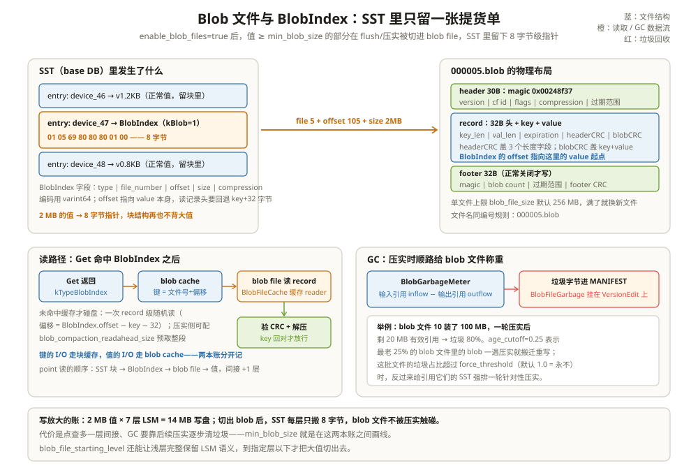

# Blob 文件存储：大值单独安家

一个文档检索服务把 2 MB 左右的文档切片直接塞进 RocksDB，跑了一个月后值班同学收到两条报警：磁盘占用是业务数据估算量的三倍；每天凌晨的压实窗口把盘打满，读延迟跟着抖。查 STATS 发现 `COMPACT_WRITE_BYTES` 高得离谱——明明这批文档大多是「写进去就不改」的冷数据。

差别不在值多大，而在**这些值被迫跟着键走完了 LSM 的每一层**。上一章结尾看到 2 MB 的值在块结构里的下场：独占一个块，然后压实每过一层就把它原样重写一遍。7 层 LSM 走完，一个 2 MB 的值实际写盘 14 MB——写放大 7 倍，而这笔钱花在搬运一堆「几乎永远不会被改」的字节上。这一章讲 RocksDB 的解法：大值在落盘时就地分流，SST 里只留一张提货单。

把 Integrated BlobDB 想成**仓库分区管理**：账本（SST）永远轻便，只有条目和提货单；大件商品不进货架（块缓存），直接躺在平层大货区（blob file）的固定坐标上，提货单写着「几号库、第几排」。



---

## 一、大值在 LSM 里的三笔账

开 blob 文件之前先把损失算清楚，才知道阈值怎么画线：

1. **SST 膨胀**。2 MB 值独占一个 data block，块与块之间的索引、布隆、统计全被稀释——同样的 4 GB 文件，entries 少两个数量级，索引查找的「性价比」下降；
2. **压实搬运**。LSM 每一层压实都会把活下来的值重写一遍。一个大值从 flush 到最底层要被完整拷贝 O(层数) 次，这是 `COMPACT_WRITE_BYTES` 里最冤枉的部分；
3. **缓存挤占**。块缓存按块分配，一个 2 MB 的冷块挤进 64 MB 的缓存，等于顶掉几百个热的小块（缓存篇细算这笔账）。

RocksDB 的答案是把「值」从这套结构里剥离：flush 和压实构建 SST 时顺手检查每个值，够大的切进独立的 blob 文件，SST 里只留指针。整套实现住在 `db/blob/` 下，选项都挂在 `AdvancedColumnFamilyOptions`（`include/rocksdb/advanced_options.h:1070-1209`）。

```text
举例：把三笔账换成数字
100 GB 业务数据，值平均 2 MB，7 层 LSM：
不开 blob：压实的主体是 2MB×层数 的搬运，写放大 ≈ 层数；
开 blob：  SST 总量 ≈ 100GB × (9B 键 + 8B 指针)/2MB ≈ 1 MB 级——
          压实搬的是提货单；blob 文件只在 GC 搬迁时被重写，
          常态接近 100 GB 静置。
读路径的账反过来：点查多一层寻址，blob cache 也要占一份内存。
```

---

## 二、Integrated BlobDB：flush/压实顺手分流

开关是 `enable_blob_files`（默认 false），打开后每个参与构建 SST 的作业（flush 和 compaction）都会多拿一个 `BlobFileBuilder`（flush 侧 `db/builder.cc:222-227`，压实侧 `db/compaction/compaction_job.cc:1617-1629`）。分流逻辑集中在 `BlobFileBuilder::Add`（`db/blob/blob_file_builder.cc:117-175`）：

```text
举例：一个值过 BlobFileBuilder::Add 的四步
value.size() < min_blob_size_ ？→ 是：直接返回，SST 照旧存值（:122-124）
否 → ① 开文件（没有就开新的，写 30 字节 header）
     ② 按需压缩
     ③ 追加 record，拿到 blob_file_number 和 blob_offset
     ④ 文件超 blob_file_size_（默认 256 MB）就封口写 footer（:378-387）
最后 BlobIndex::EncodeBlob 把「文件号+偏移+大小+压缩类型」
编成指针塞给 SST 构建器（:171-172）。
```

关键在于**顺手**二字：分流发生在 flush/压实本来就要遍历每个 KV 的路上，不额外扫一遍；blob 文件以 append-only 方流式追加，和 SST 一样是单遍写的不可变文件。`min_blob_size` 默认 0——开了开关就把所有值都切出去，实际使用几乎总要调高它（选型见第七节）。

```text
举例：一次 flush 的时间线（enable_blob_files=true, min_blob_size=1KB）
memtable 里 1000 个键值：700 个 200B 小值 + 300 个 2MB 文档切片。
flush 开始 →
  前 700 个小值：BlobFileBuilder::Add 短路（< 1KB），照旧进 SST 块；
  第 701 个大值：打开 000007.blob（写 30B header）→ 压缩（若配）
                → 追加 record → 拿到 (file=7, offset=30+32+len(key))；
  后续大值继续追加，直到 256 MB 上限 → 封口写 32B footer → 开 000008.blob；
  SST 构建器把 300 张 8 字节提货单写进 data block。
结束：一个 ~2.3 MB 的 SST（原来要 600 MB），两个 blob 文件。
```

---

## 三、BlobIndex：一张 8 字节的提货单

SST 里的值换成 `kTypeBlobIndex` 类型，内容按 `db/blob/blob_index.h:29-41` 的布局编码。三种形态里最常见的是 `kBlob`：

| 字段 | 编码 | 本例值 | 字节 |
| --- | --- | --- | --- |
| type | char（kBlob=1） | 0x01 | 1 |
| file number | varint64 | 5 → `05` | 1 |
| offset | varint64 | 105 → `69` | 1 |
| size | varint64 | 2 MB → `80 80 80 01` | 4 |
| compression | char | kNoCompression → `00` | 1 |

```text
举例：2 MB 换 8 字节
01 05 69 80 80 80 01 00
2 MB = 2^21，varint64 要 4 字节；文件号 5 和偏移 105 都小于 128，各占 1 字节。
指针与值的尺寸比 1:260000。带 TTL 的场景用 kBlobTTL，头部多一个 varint64
过期时间；「内联 TTL 值」是 kInlinedTTL（blob_index.h:47-52）。
```

注意分流的时机：在默认方案里，值在 memtable 和 WAL 里仍是完整的，**提货单是 flush/压实时才开出的**——所以写路径的缓冲区照旧要背大值，真正的卸载发生在落盘那一刻。第七节提到的 `enable_blob_direct_write` 要解决的正是这一段：把开提货单的动作提前到写路径。

一个容易踩的细节：**BlobIndex 的 offset 指向 value 本身，不是 record 头**。blob record 有 32 字节头加 key，读完整记录要回退 `key_size + 32` 字节——这个换算就是 `BlobLogRecord::CalculateAdjustmentForRecordHeader`（`db/blob/blob_log_format.h:125-128`）。偏移合法性还有一道廉价体检：最小前缀、文件边界、footer 预留都在 `IsValidBlobOffset` 里过一遍（`db/blob/blob_log_format.h:150-175`）。

---

## 四、blob file 的物理布局

blob 文件（`000005.blob`，后缀定义在 `file/filename.cc:33`，命名 `:88-90`）是一段日志，三段式结构（`db/blob/blob_log_format.h`）：

| 段 | 大小 | 内容 |
| --- | --- | --- |
| header | 30 字节（`:44`） | magic `0x00248f37`、version、cf id、flags、压缩类型、过期范围（`:27-44`） |
| record | 32 字节头 + key + value（`:120`） | key_len/val_len/expiration（各 Fixed64）+ headerCRC（盖三个长度字段）+ blobCRC（盖 key+value）+ 数据（`:96-116`） |
| footer | 32 字节（`:83`） | magic、blob count、过期范围、footer CRC；**只有正常关闭才写**（`:67-92`） |

和 SST 的块结构比，blob 文件刻意「退回」了日志格式：不用块、不用前缀压缩、不用 varint（注释明说「可以用 Varint64 省空间但让 reader 更复杂」，`:113-114`）——因为它的访问模式是「按偏移直取一条」，不是「按序扫描」。CRC 分两层也是这个逻辑：headerCRC 先验「我有没有读错位置」，blobCRC 再验「这条数据本身完不完整」。文件没有块级压缩，压缩以 record 为单位（BlobIndex 里记着每条的压缩类型）。

```text
举例：一条 record 的字节地图（key="device_47" 9B，value 2MB 未压缩）
offset 30（header 之后）：record 起点
  [key_len=9][val_len=2097152][expiration=0][headerCRC][blobCRC]  ← 32B 头
  [device_47][2MB value]                                        ← 数据
BlobIndex 里记的 offset = 30 + 32 + 9 = 71，直指 value 第一字节。
校验路径要把回退 41 字节把头也读出来；快路径直接读 71 起的 2MB。
一个 256 MB 的 blob 文件装 2MB 的值 ≈ 128 条 record——
文件级顺序、record 级随机，这是"日志皮、索引骨"的访问模式。
```

---

## 五、读路径：点查多一层间接

Get 命中一个 `kTypeBlobIndex` 时，`SaveValue` 不返回值，而是把「这是个 blob 引用」标记传出去（`table/get_context.cc:449-470`），由 DBImpl 侧解析。解析的完整链条在 `db/blob/`：

1. **拼缓存键**：`OffsetableCacheKey(db_id, db_session_id, 文件号)` 再拼偏移（`db/blob/blob_source.h:303-308`，调用点 `db/blob/blob_source.cc:287`）；
2. **查 blob cache**（独立于块缓存的 Cache 对象，`include/rocksdb/advanced_options.h:1198`）：命中直接返回；
3. **miss 则取 reader**：`BlobFileCache` 缓存的是**已打开的文件 reader 对象**而不是文件内容（`db/blob/blob_file_cache.cc:40-107`）——几百个 blob 文件的句柄、压缩器、文件大小守在内存里，内容按需读；
4. **读 record**：`BlobFileReader::GetBlob` 按偏移读「value 或整条记录」（`verify_checksums` 决定要不要回退读头），先验 CRC、再解压（`db/blob/blob_file_reader.cc` 的 `VerifyBlob` `:844`、`UncompressBlobIfNeeded` `:888`）。

```text
举例：一次 blob 点查的 I/O 账
Get("device_47")：
SST 侧：filter + index + data block（老三样，块缓存兜着）→ 拿到 8 字节 BlobIndex
blob 侧：blob cache 命中 → 0 次盘读；
       miss → 1 次 record 级随机读（正常值大小，不再是块级 4KB）
和不开 blob 比：盘上字节从"块级"降到"值级"，但多一层寻址。
压实时还要读回旧 blob 做校验/搬迁，可用 blob_compaction_readahead_size
预取整段把随机读变顺序读（include/rocksdb/advanced_options.h:1168-1173）。
```

MultiGet 也有专门路径：同一文件的多个 blob 引用合并成一次顺序读（`db/blob/blob_source.h:238` 起）。blob cache 可以与块缓存共用作同一个 Cache 对象，但 blobs 在缓存里天然低一等——注释明确提示用优先级池把它们压到 low priority（`include/rocksdb/advanced_options.h:1190-1195`）。

```text
举例：缓存键怎么保证 blob 不读串
blob cache 键 = OffsetableCacheKey(db_id, db_session_id, 文件号)
              再拼上偏移（db/blob/blob_source.h:303-308）。
两个库各有一个 000007.blob？db_id/session_id 参与键的基座
（和 SST 块缓存键同一族），混用同一个缓存也不撞。
同一文件内偏移 71 和偏移 71 之外的记录天然不同键。
读取结果以 BlobContents 的形态进缓存，按实际字节计费，不占块的配额。
```

---

## 六、GC：压实时给 blob 文件称重

blob 文件脱离了 LSM，也就没有了「压实顺带清旧版本」的待遇：SST 层层翻新，blob 文件里的旧 blob 却原地不动，谁也不去清。RocksDB 的方案是**让压实顺路做回收统计，再决定搬不搬**：

- **称重**：`BlobGarbageMeter` 对压实的每个输入/输出 SST 解析 BlobIndex，按 blob 文件聚合「流入引用 inflow − 流出引用 outflow」，差值就是这个文件新增的垃圾（`db/blob/blob_garbage_meter.h:26-68`）；压实收尾时把每个文件的垃圾字节写进 MANIFEST 的 `BlobFileGarbage`（`db/compaction/compaction_job.cc:2410-2439`）；
- **按龄搬迁**：`blob_garbage_collection_age_cutoff`（默认 0.25）圈出最老的四分之一 blob 文件；压实时遇到这些文件里的有效 blob，就重新写入新文件、更新 BlobIndex——老文件的引用数因此下降，直到清空可删（判定切点在 `db/compaction/compaction_iterator.cc:2021-2041`）；
- **按垃圾比强推**：垃圾占比超过 `blob_garbage_collection_force_threshold`（默认 1.0，即默认永不触发）时，反向找到引用这批文件的 SST，把它们标记成强压对象（`db/version_set.cc:4021-4114` 的 `ComputeFilesMarkedForForcedBlobGC`，注释里的 SST↔blob 文件映射例子很值得一读）。

```text
举例：一轮 GC 的账
blob 文件 10 有 100 MB，最老 25% 圈内。
一轮压实后只剩 20 MB 有效引用 → 垃圾 80%。
age_cutoff=0.25 ⇒ 后续压实路过它时继续搬走那 20 MB；
清空后文件删除。若想让"垃圾多就快点收"，把 force_threshold
降到 0.5：垃圾比过半就强排一轮针对压实的 SST。
```

注意 GC 的主体仍是**常规压实**：blob 的搬迁发生在「压实路过引用它的 SST」时，不单设后台进程——省下的是一套独立的调度，付出的是回收速度取决于 SST 的压实节奏。统计的闭环是这样的：压实输出的 VersionEdit 除了常规的「新增/删除 SST 文件」，还挂两样 blob 侧的记录——`BlobFileAddition`（本次新开的 blob 文件）和 `BlobFileGarbage`（本次称出的旧文件垃圾量），随 MANIFEST 一起原子生效（`db/compaction/compaction_job.cc:2410-2439`）。Version 随之知道每个 blob 文件「登记了多少字节、还剩多少有效」，强推 GC 的阈值判断读的就是这份账。

---

## 七、选型：什么时候开 blob

| 参数（默认值） | 语义 | 调法 |
| --- | --- | --- |
| enable_blob_files（false） | 总开关 | 值明显偏大（≥ 数 KB 且量大）才开 |
| min_blob_size（0） | 小于它的值留在 SST | **核心旋钮**：典型 4 KB~64 KB；太小则间接寻址开销压过写放大收益 |
| blob_file_size（256 MB） | 单文件上限 | 太小则文件碎、GC 粒度细；太大则回收慢 |
| blob_compression_type（kNoCompression） | blob 侧压缩 | 大 JSON/文档可上 ZSTD；与 SST 压缩独立 |
| blob_garbage_collection_age_cutoff（0.25） | 最老 N% 文件参与搬迁 | 值更新越快，cutoff 越值得调大 |
| blob_garbage_collection_force_threshold（1.0） | 垃圾比超过才强推 | 默认等于关闭；垃圾积压明显时降到 0.5 |
| blob_file_starting_level（0） | 从某层才开始切大值 | 短命大值场景调高：浅层保持完整 LSM 语义，活过几轮压实的才分流 |

经验判据一句话：**写多读少、值大、更新率低**——三个条件凑齐，blob 几乎稳赚；值不大、点查极热，多一层间接是纯亏。11.x 还有一个实验性的写路径直写方案 `enable_blob_direct_write`（值在写入时直接进 blob 文件，WAL/memtable 里就只留引用，`include/rocksdb/advanced_options.h:1211-1248`），由 `db/blob/blob_file_partition_manager.cc` 的分区管理器按 memtable 代次成批登记（`db/blob/blob_file_partition_manager.h:35-45` 的设计注释）——这一章以成熟的 flush/压实分流为主线。另需分清：`utilities/blob_db/` 下还有一个更早的**独立** BlobDB 包装层（`utilities/blob_db/blob_db.h:21-22` 自述为「把值放单独日志、在底层库里存位置」的 wrapped database），带 TTL/过期等独立功能，如今的标准方案就是本章的 Integrated BlobDB，老包装层不建议新项目采用。

**反过来，这几种负载别开 blob**：

- 值普遍在几百字节到 1 KB：min_blob_size 划不出一条有意义的线，切出去省的写放大抵不过每个值多一层寻址；
- 点查极热且值偶有大者：热键的值每读一次都要过 blob cache 一道，把 blob cache 关了的话更是每次多一次盘读；
- 值大但每条都会被快速覆盖/删除：blob 变垃圾的速度快过 GC 搬迁的速度，磁盘反而更满——这正是 `blob_file_starting_level` 存在的原因：让短命大值在浅层保持「随压实自然消亡」的原语义，活过几轮压实的才分流（`include/rocksdb/advanced_options.h:1175-1188`）；
- 需要严格单次 I/O 的点查 P99：blob 读路径的「SST 块 → 提货单 → blob 文件」三段里任何一段缓存 miss 都会加一层延迟抖动。

与分层存储的配合是 blob 的加分项：blob 文件本身支持温度标记，SST 侧的 `Temperature`（如 `SstFileWriter::Open` 的 `temp` 参数，`include/rocksdb/sst_file_writer.h:129-130`）与 `blob_file_starting_level` 一起，能把「冷数据的大值」成批送到低温盘，账本留在热盘。

---

## 八、踩坑清单

三个高频误解先摆平。**误解一：「开了 blob 文件就万事大吉」。** GC 搬迁发生在压实路过引用 SST 时，压得不勤的库 blob 垃圾照样堆积——开关只是给了回收一条路，回收的节奏还是压实的节奏。**误解二：「BlobIndex 里的 offset 是记录头」。** 它指向 value 本身，少读的 41 字节（32B 头 + key）恰好是校验路径必须补回来的——`verify_checksums=false` 的快路径省的就是这次回读。**误解三：「blob 文件是 SST 的替代」。** 键和多版本管理全在 SST 里，blob 文件只是值的仓库；把 blob 文件当独立数据源恢复，等于拿着一堆没有账本的提货单。

| 现象 | 更可能的原因 | 先看哪里 |
| --- | --- | --- |
| 开 blob 后空间没降反升 | min_blob_size 太低，小值全被切出还带 32B 头开销 | TableProperties/STATS 里的 blob 文件字节数分布 |
| 点查 P99 长尾变差 | blob cache 未配（默认 nullptr，`advanced_options.h:1198`） | blob_cache 是否独立配置、命中计数 |
| blob 文件只增不减 | GC 未开（enable_blob_garbage_collection 默认 false） | 三个 GC 选项是否齐全、压实是否在跑 |
| 压实期间读大值变慢 | 压实读 blob 与前台读抢盘 | blob_compaction_readahead_size、压实限速 |
| `Invalid blob offset` 报错 | blob 文件与 SST 引用不同步（恢复/手工删除） | MANIFEST 里 BlobFileAddition/Garbage 记录 |
| force_threshold 调低后 CPU 飙升 | 强排压实把引用 SST 反复重写 | 阈值回调、压实限流 |

---

## 九、和 Parquet 摆在一起看：大值外置与整文件重写

数据湖实践里有一条和 blob 分流完全同构的军规：**宽表别把大 payload（原始报文、图片、长文本）塞进 Parquet 行组**。理由逐条对得上：大 payload 撑爆行组（≈ 大值撑爆 data block）；任何只查小列的扫描也要为它付 I/O（≈ 缓存被冷块挤占）；payload 一变就得重写整个行组（≈ 压实反复搬运大值）。两边的一致答案是「列/表里留指针，payload 另存」——Parquet 生态里通常外挂到对象存储再由元数据层引用，RocksDB 里就是 BlobIndex。

回收机制的分野更值得细看。SST 只留指针 + 引用统计，GC 是**引用计数式**的：`BlobGarbageMeter` 数清楚每个 blob 文件还剩几个有效引用，降到零就整文件退役，回收粒度是单个 blob。Parquet 没有这条路——行组内部没有引用计数，删改只能**重写整个文件**（或引入 merge-on-read 的删除文件，把账记到表格式层）。换句话说，RocksDB 把「细粒度回收」做进了存储格式，Parquet 把这件事整个推给了上层的 Iceberg/Delta。不可变文件既然不改，垃圾回收就必然发生在「重写」这个动作里——区别只是重写的单位是一个 blob、一个 SST，还是一整个 Parquet 文件。

---

## 这一章留下的线索

- 大值在 LSM 里付三笔账：SST 膨胀、压实 O(层数) 搬运、缓存挤占；`enable_blob_files` 让 flush/压实顺手把 ≥ min_blob_size 的值切出去；
- SST 里留 BlobIndex：type + 文件号 + 偏移 + 大小 + 压缩类型，2 MB 换 8 字节；offset 指向 value，读整条记录要回退 key+32 字节；
- blob file 是 append-only 日志：30 字节头、32 字节记录头（双 CRC：定位与内容各一层）、关闭时写 32 字节 footer；
- 读路径多一层间接：SST 块 → BlobIndex → blob cache / blob file；BlobFileCache 缓存的是 reader，blob cache 缓存的是内容；
- GC 靠压实时称重：BlobGarbageMeter 算 inflow−outflow 进 MANIFEST，age_cutoff 圈最老文件搬迁，force_threshold 反向强排引用它们的 SST；默认阈值下回收节奏由常规压实决定。

到这里，SST 的骨架、块的内部、大值的去处都齐了——但所有这些读盘动作最终都要回答一个问题：**读回来的块放在哪、谁替它们记账、怎么不被挤爆**。下一章进入缓存体系：[块缓存架构：读过的块留在内存里](../cache/01-块缓存架构.md)。

---

## 附：这一章的源码入口

> 除特别注明外，本节引用的源码文件与行号都来自 facebook/rocksdb 主分支（11.13.0）。

- `include/rocksdb/advanced_options.h:1070-1209`：blob 全家桶选项及默认值——enable_blob_files/min_blob_size/blob_file_size/blob_compression_type/GC 三参数/blob_cache
- `db/builder.cc:222-227` 与 `db/compaction/compaction_job.cc:1617-1629`：flush 与压实各自创建 BlobFileBuilder 的位置
- `db/blob/blob_file_builder.cc:117-175`：`Add` 四步——min_blob_size 短路、压缩、落 record、生成 BlobIndex
- `db/blob/blob_file_builder.cc:378-387`：`CloseBlobFileIfNeeded`——blob_file_size 触发封口
- `db/blob/blob_index.h:18-44、47-52、180-191`：三种 BlobIndex 布局注释、类型枚举、kBlob 编码实现
- `db/blob/blob_log_format.h:27-44、96-116、125-128、150-175`：header 30B、record 32B 头布局、offset 回退换算、偏移合法性体检
- `table/get_context.cc:449-470`：Get 命中 kTypeBlobIndex 的标记与透传
- `db/blob/blob_source.cc:275-378`：`BlobSource::GetBlob`——缓存键、blob cache、reader 取数的完整主干
- `db/blob/blob_file_cache.cc:40-107`：`BlobFileCache::GetBlobFileReader`——缓存 reader 对象而非内容
- `db/blob/blob_file_reader.cc:844、888`：`VerifyBlob` 双 CRC 校验与 `UncompressBlobIfNeeded`
- `db/blob/blob_garbage_meter.h:26-68`：BlobGarbageMeter 的 inflow/outflow 模型与垃圾计算
- `db/compaction/compaction_job.cc:2410-2439`：压实收尾把垃圾字节聚合成 BlobFileGarbage 写进 MANIFEST
- `db/compaction/compaction_iterator.cc:2021-2041`：age_cutoff 换算成 cutoff blob 文件号
- `db/version_set.cc:4021-4114`：`ComputeFilesMarkedForForcedBlobGC`——垃圾比超阈值反向强排 SST
- `db/blob/blob_file_partition_manager.h:35-45` 与 `include/rocksdb/advanced_options.h:1211-1248`：11.x 写路径直写的分区管理与实验限制
- `utilities/blob_db/blob_db.h:21-22`：旧独立 BlobDB 的自我定位（wrapped database）

---

## 思考题

1. 业务键值 60% 是 100 字节的小值、40% 是 1 MB 的文档切片。`min_blob_size` 分别取 0、4 KB、128 KB 时，估算写放大和点查 P99 各怎么变？你会选哪个？
2. `blob_garbage_collection_force_threshold` 默认 1.0 意味着什么？一个只写不删的工作负载把它调到 0.5 会有什么副作用？提示：想一想 GC 的「搬迁重写」发生在谁身上。
3. BlobIndex 的 offset 指向 value 而非记录头，读取时要回退 `key_size + 32`。这个设计给「不校验 CRC 的快路径」省了什么？代价是什么？（对比：如果 offset 指向记录头，两条路径各读多少字节？）
4. 数据湖团队把 1 KB 的用户画像 JSON 内联进了 Parquet 行组的 `profile` 列，扫描量涨了 40 倍。用本章「大值外置」的思路给一个迁移方案：指针放哪、payload 放哪、引用怎么随删除失效？和 RocksDB 的 BlobIndex 相比，谁负责回收？
