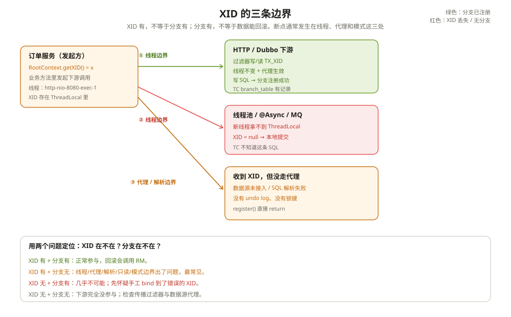

# XID 的边界：传播、代理与那些看起来在事务里的调用

排查过这样一个问题。

订单服务、库存服务、积分服务的日志里，XID 是同一个。订单回滚了，库存回滚了，积分没回滚。查 TC 的分支表，只有两个分支。积分服务的日志里明明有一句 `update points set ...`，也提交成功了。

积分服务的同学说：XID 都有，怎么会不在事务里？

XID 有，只说明这根线传过来了。线那头有没有挂上分支，取决于三件事：SQL 有没有走 Seata 的代理、代理有没有解析出可回滚的语句、执行 SQL 的线程有没有拿到 XID。任何一环断了，SQL 都会变成一个普通本地事务，TC 根本不知道它存在。

这一章把这三条边界拆开。

---

## 一、XID 不是事务，它只是一根线

`RootContext` 里存的 XID，本质是一个字符串。`bind()` 就是往当前线程的上下文里放一个键值对：

```java
public static void bind(@Nonnull String xid) {
    ...
    CONTEXT_HOLDER.put(KEY_XID, xid);
}
```

底层默认是 `ThreadLocal`（Netty 环境下可能用 `FastThreadLocal`）。它不是 `InheritableThreadLocal`，也不会自动跟着线程池、消息队列、响应式链路走。

XID 能回答的问题是：「这次调用属于哪笔全局事务？」它不能回答：「这笔全局事务在 TC 那边有几个分支、每个分支是什么状态？」后者要看 TC 的 `branch_table` 和 RM 的 `undo_log`。

`RootContext.inGlobalTransaction()` 的判断也很简单：当前线程的 `KEY_XID` 不为空。它不检查 TC 那边有没有这个 XID，也不检查当前服务有没有注册分支。所以一个失效的 XID、一个手工 bind 的 XID、一个从消息头里抄来的 XID，都能让 `inGlobalTransaction()` 返回 true。

---

## 二、传播链：谁把 XID 送过边界

Seata 自己的 RPC 不需要额外的 header。XID 是请求体里的字段，比如 `BranchRegisterRequest.xid`、`BranchCommitRequest.xid`。`AbstractNettyRemotingClient.getXid()` 会从请求对象里把 XID 取出来，用于选择 TC 节点。

业务服务之间的调用是另一回事。Seata 提供了几套过滤器：

**HTTP**：客户端在请求头里写 `TX_XID`，服务端拦截器读出来 bind。

```java
// 客户端
String xid = RootContext.getXID();
if (xid != null) {
    headers.put(RootContext.KEY_XID, xid);
}

// 服务端
String rpcXid = request.getHeader(RootContext.KEY_XID);
if (StringUtils.isBlank(RootContext.getXID()) && StringUtils.isNotBlank(rpcXid)) {
    RootContext.bind(rpcXid);
}
```

**Dubbo**：consumer 把 XID 和分支类型放进 attachment，provider 读出来 bind。`TransactionPropagationHandler` 会同时处理 `TX_XID` 和 `TX_BRANCH_TYPE`，但分支类型的处理目前只覆盖 TCC。

**其他 RPC**：HSF、Motan 各有一套 consumer/provider filter，逻辑和 Dubbo 类似。

这里有一个容易被忽略的差异：**HTTP 只传 XID，不传分支类型。** 下游收到 XID 后，`RootContext.getBranchType()` 会返回默认的 `AT`（如果当前线程没有显式绑定过分支类型）。如果上游是 TCC，下游又走了一个 AT 数据源，下游会注册一个 AT 分支，而不是 TCC 分支。跨模式混用时，这个差异会让 TC 的分支类型和你的预期对不上。

---

## 三、线程边界：XID 不会自己长脚



这是最常见的断点。

```java
@GlobalTransactional
public void createOrder() {
    orderDao.insert(order);
    executor.submit(() -> stockDao.deduct(order));  // 新线程
}
```

`executor.submit()` 里的线程拿不到父线程的 `ThreadLocal`。`RootContext.getXID()` 返回 null，`DataSourceProxy` 不会把这个连接当成全局事务的一部分，`stockDao.deduct()` 直接本地提交。订单回滚时，库存不会回滚。

`@Async`、`CompletableFuture.supplyAsync()`、消息监听、定时任务、Reactor 的 `publishOn()`，都是同一个问题。Seata 没有内置的线程上下文传播，得自己把 XID 带过去：

```java
String xid = RootContext.getXID();
executor.submit(() -> {
    RootContext.bind(xid);
    try {
        stockDao.deduct(order);
    } finally {
        RootContext.unbind();
    }
});
```

这段代码有两个细节：

- `bind` 之前先捕获 XID，不要在子线程里调 `RootContext.getXID()`；
- `finally` 里必须 `unbind`。线程池的线程是复用的，这次不清理，下一个任务可能会 bind 到上一笔已经结束的全局事务上。

如果父线程本身已经在全局事务里，子线程 bind 同一个 XID 是安全的；如果父线程没有 XID，`bind(null)` 会走到 `unbind()`，不要传 null 进去。

响应式链路更麻烦。Reactor 的上下文不在 ThreadLocal 里，`publishOn` 切换线程后，`RootContext` 就断了。要么在关键操作前从 Reactor Context 里取出 XID 再 bind，要么把数据库操作收敛到同一条阻塞链路上。Seata 的自动配置不会帮你做这件事。

---

## 四、代理边界：SQL 有没有被看见

XID 传到了，线程也对了，SQL 还是可能没进全局事务。

`ExecuteTemplate.execute()` 的第一行是分流：

```java
if (!RootContext.requireGlobalLock() && BranchType.AT != RootContext.getBranchType()) {
    return statementCallback.execute(statementProxy.getTargetStatement(), args);
}
```

不在全局事务、也没有 `@GlobalLock`，SQL 直接走原生 Statement。XID 在不在，和这行判断没关系；判断的是分支类型和全局锁标志。

进了全局事务后，还有三道关：

**第一道，SQL 解析。** `SQLVisitorFactory.get()` 用 Druid 把 SQL 解析成 `SQLRecognizer`。解析失败，退化成 `PlainExecutor`，原样执行，不生成镜像、不注册分支。存储过程、某些方言、动态拼接的 SQL 都可能走到这里。

**第二道，分支注册条件。** `ConnectionProxy.register()` 只有在「有 undo log」且「有锁键」时才注册分支：

```java
if (!context.hasUndoLog() || !context.hasLockKey()) {
    return;
}
```

只读 SQL 没有 undo log，也没有锁键，所以不注册分支。这是正常的，但如果你的服务只做查询，却在全局事务里期待它出现在 TC 的分支表里，就会误判。

**第三道，数据源代理。** 只有经过 `DataSourceProxy` 的连接才会创建 `ConnectionProxy`。如果下游服务用的是另一个数据源、直连的 JDBC、或者 MyBatis 自己拿的连接，XID 再正确也不会产生分支。

开头那个积分服务的故障，就是第三道关：它用了一个没有接入 Seata 的数据源。XID 在日志里，SQL 也执行了，但 TC 从来没收到过这个分支。

还有一个隐蔽的变体：数据源接入了，但 SQL 走的是同一个类里的自调用方法，Spring 的代理没生效，`@GlobalTransactional` 也没生效。XID 可能是从上游传下来的，分支却不会注册。

---

## 五、模式边界：TCC、Saga、XA 的 XID 不一样

AT 的 XID 边界比较直观：有代理、有镜像、有锁键，就有分支。TCC、Saga、XA 各有各的规则。

**TCC**：分支在 try 之前注册，`resourceId` 是 `actionName`，不是数据源。confirm/cancel 是本地方法调用，不需要 XID 再传一次。跨服务调 TCC 接口时，XID 要传，分支类型也要传；只传 XID，下游可能按 AT 处理。

**Saga**：默认不给每个状态注册分支，TC 眼里只有一个 `branchId=-1` 的虚拟分支。你在下游看到的 XID 是真的，但 TC 的分支表里可能只有一条。用分支数判断 Saga 进度会误判。

**XA**：分支在 `setAutoCommit(false)` 时注册，`resourceId` 是数据源。XA 要求物理连接初始 `autoCommit=true`；如果连接池或上层 `@Transactional` 先把连接改成 `autoCommit=false`，`ConnectionProxyXA.init()` 会直接抛异常。这个异常经常被误判成「XA 不支持这个库」，实际是连接配置的顺序问题。

还有一个跨模式的细节：`RootContext.getBranchType()` 在 XID 存在但没有显式绑定分支类型时，返回默认的 `AT`。HTTP 传播只带 XID，不带分支类型；Dubbo 的 `TransactionPropagationHandler` 也只对 TCC 做了分支类型绑定。**XID 能跨过去，不代表模式能跨过去。**

---

## 六、`@GlobalLock` 的边界更窄

`@GlobalLock` 不是全局事务。它只是让当前线程的 SQL 走代理，并在本地提交前向 TC 查一次全局锁。

`RootContext.bindGlobalLockFlag()` 设置的是当前线程的 `TX_LOCK` 标志，不是 XID。这个标志不会随 HTTP 或 Dubbo 传播；它只影响当前 JVM 里这次调用的代理行为。

所以下面这种写法是无效的：

```java
@GlobalLock
public void updateStock() {
    // 以为这里会拦住其他全局事务
}
```

如果这个方法没走 `DataSourceProxy`，或者 SQL 解析失败退化成 `PlainExecutor`，`@GlobalLock` 什么也拦不住。它不是一个跨服务的锁，它是「当前线程、当前数据源、当前 SQL」的本地检查。

`@GlobalLock` 真正有用的场景是：一个不走全局事务的本地操作，需要确认某行没有被全局事务占用。比如定时任务更新库存前，先用 `@GlobalLock + SELECT ... FOR UPDATE` 查一下。它查的是 TC 的锁表，不是数据库的行锁。

---

## 七、一张诊断表

排「XID 有、事务没生效」这类问题时，按这个顺序看：

| 症状 | 先看什么 | 常见根因 |
| --- | --- | --- |
| 日志里 XID 一样，TC 分支数少 | `branch_table`、RM 的 `branchRegister` 日志 | 只读 SQL、SQL 解析失败、数据源没代理、线程丢了 XID |
| 下游报 `Global transaction already exists` | 当前线程 `RootContext.getXID()` | 线程池复用时没 `unbind`，或者手动 bind 了旧 XID |
| 回滚时某个服务的数据没动 | 该服务的 `undo_log`、TC 分支表 | 这个服务根本没注册分支，或者分支类型不是 AT |
| TCC 的 cancel 没执行 | TC 分支的 `resourceId`、`actionName` | actionName 不匹配，或者分支在 try 之前没注册上 |
| XA 启动报 `autocommit=false is NOT supported` | 连接池初始配置、上层事务拦截器 | 连接交给 Seata 之前已经被改成手动提交 |
| `@GlobalLock` 没拦住并发写 | SQL 是否走代理、是否解析成功 | 它只查 TC 锁表，不是数据库锁；代理没生效就什么都不做 |

---

## 八、踩坑清单

- 在 `@Async`、线程池、消息监听里直接做数据库操作，不手动 bind XID：分支一定漏。
- 子线程 bind 了 XID，却不在 `finally` 里 unbind：线程池复用后，下一个任务会 join 到旧事务。
- 只看日志里的 XID 判断事务是否生效：要看 TC 分支表和本地 `undo_log`。
- 数据源接入了 Seata，但业务用自调用、私有方法、final 方法：代理没生效，XID 也救不了。
- HTTP 只传了 XID，没传分支类型，下游又用了 TCC：下游会按默认的 AT 处理。
- 以为 Saga 的每个状态都有分支：默认只有一个虚拟分支，`branchId=-1`。
- 以为 `@GlobalLock` 是跨服务锁：它只是当前线程、当前数据源的一次本地检查。
- XA 连接池默认 `autoCommit=false`：Seata 初始化时直接拒绝，不是数据库不支持 XA。

---

## 附：这一章的源码入口

XID 的存取：

```text
RootContext.bind()                                    :126
  → CONTEXT_HOLDER.put(KEY_XID, xid)
RootContext.unbind()                                  :167
RootContext.inGlobalTransaction()                     :190
RootContext.getBranchType()                           :222   // 默认 AT
ContextCore 默认实现                                   ThreadLocalContextCore:29
```

一次请求的 XID 传播：

```text
HTTP 客户端 AbstractHttpExecutor                      :141（写 TX_XID）
HTTP 服务端 TransactionPropagationInterceptor         :36（读 TX_XID）
  → RootContext.bind()                                :57
Dubbo consumer filter
  → TransactionPropagationHandler.getTransactionPropagationContext()  :33
Dubbo provider filter
  → bindProviderContext()                             :46
```

分支是否真的注册：

```text
ExecuteTemplate.execute()                             :78
  → SQLVisitorFactory.get()                           // 解析失败退 PlainExecutor
ConnectionProxy.register()                            :267
  → if (!hasUndoLog() || !hasLockKey()) return
  → DefaultResourceManager.branchRegister()
```

| 本文结论 | 源码证据 | 照搬之前先确认 |
| --- | --- | --- |
| XID 是线程本地变量，不自动跨线程 | `RootContext.bind():126`、`ThreadLocalContextCore:31` | 你的异步链路是否有手动 bind/unbind |
| HTTP 只传 XID，不传分支类型 | `AbstractHttpExecutor:141`、`TransactionPropagationInterceptor:57` | 跨服务是否混用 TCC/XA/AT |
| 只读 SQL 不注册分支 | `ConnectionProxy.register():267` | 你是否用分支数判断全局事务覆盖范围 |
| SQL 解析失败会退化成普通执行 | `ExecuteTemplate.execute():78`、`:84` | 你的 SQL 方言/存储过程是否在代理覆盖范围内 |
| `@GlobalLock` 标志不跨服务 | `RootContext.bindGlobalLockFlag():152` | 你是否把它当成分布式锁用 |

入口清单：

- `core/src/main/java/org/apache/seata/core/context/RootContext.java`：`getXID()`（`:117`）、`bind()`（`:126`）、`unbind()`（`:167`）、`inGlobalTransaction()`（`:190`）、`getBranchType()`（`:222`）、`bindGlobalLockFlag()`（`:152`）
- `core/src/main/java/org/apache/seata/core/context/ThreadLocalContextCore.java`：`threadLocal`（`:31`）
- `core/src/main/java/org/apache/seata/core/context/FastThreadLocalContextCore.java`：`@LoadLevel`（`:29`）
- `tm/src/main/java/org/apache/seata/tm/api/TransactionalTemplate.java`：`execute()`（`:180`）、`cleanUp()`（`:529`）
- `tm/src/main/java/org/apache/seata/tm/api/DefaultGlobalTransaction.java`：`suspend()`（`:493`）
- `extensions/rpc/seata-http/src/main/java/org/apache/seata/integration/http/AbstractHttpExecutor.java`：写 `TX_XID`（`:141`）
- `extensions/rpc/seata-http/src/main/java/org/apache/seata/integration/http/TransactionPropagationInterceptor.java`：`preHandle()`（`:36`）、`bind()`（`:57`）
- `extensions/rpc/seata-rpc-core/src/main/java/org/apache/seata/integration/rpc/core/TransactionPropagationHandler.java`：`getTransactionPropagationContext()`（`:33`）、`bindProviderContext()`（`:46`）
- `extensions/rpc/seata-dubbo-alibaba/src/main/java/org/apache/seata/integration/dubbo/alibaba/AlibabaDubboTransactionConsumerFilter.java`：consumer 传播
- `extensions/rpc/seata-dubbo-alibaba/src/main/java/org/apache/seata/integration/dubbo/alibaba/AlibabaDubboTransactionProviderFilter.java`：provider 绑定（`:41`）
- `rm-datasource/src/main/java/org/apache/seata/rm/datasource/exec/ExecuteTemplate.java`：`execute()`（`:78`）、直通分支（`:84`）
- `rm-datasource/src/main/java/org/apache/seata/rm/datasource/ConnectionProxy.java`：`register()`（`:267`）
- `core/src/main/java/org/apache/seata/core/rpc/netty/AbstractNettyRemotingClient.java`：`getXid()`（`:321`）

---

## 思考题

1. 一个 `@Async` 方法里执行的 SQL，XID 没有传过去。它会在 TC 留下分支吗？如果不会，全局事务回滚时它的数据会怎样？
2. 一个只读服务收到了 XID，执行了三条 SELECT。TC 的分支表里有它吗？如果没有，能说它「没参与全局事务」吗？
3. HTTP 传播只带 XID，不带分支类型。上游是 TCC，下游是 AT 数据源，下游会注册成什么类型的分支？这会造成什么问题？
4. 你现在的系统里，哪些地方手动 bind 了 XID？这些地方是否都在 `finally` 里 unbind 了？如果没有，线程池复用后可能发生什么？
