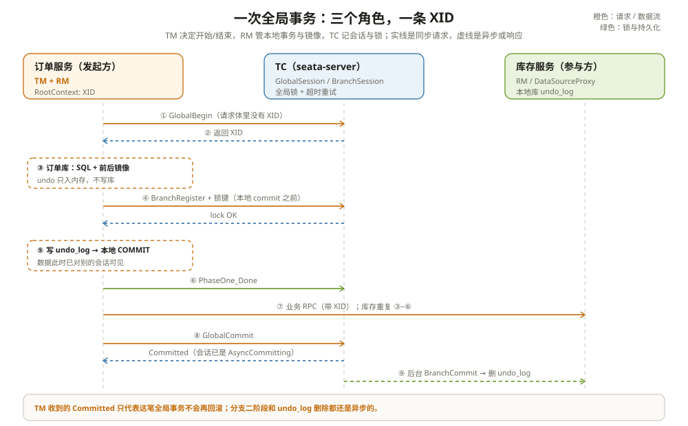

# 架构概述：一条 XID 看 Seata 的分层

先说一个真实故障。

订单服务加了 `@GlobalTransactional`，库存扣减失败，订单库回滚了，库存库没回滚。查日志，两个服务打印的 XID 一模一样；查库存服务的日志，`branch_register` 也发出去了。再查 TC 的 `branch_table`，只有订单一个分支。

最后发现，库存服务那次扣减走的是另一个数据源。那个数据源没有经过 Seata 的 `DataSourceProxy`，SQL 直接在本地事务里提交了。XID 在，分支不在。

这个故障把 Seata 的底牌露了出来：**XID 不是事务本身，它只是一根线。线上挂不挂分支，挂上之后谁负责回滚，是另外几件事。**

先把这套剖析的路线摆出来。后面每一篇都挂在下面这条链上：

- [核心角色：TC、TM、RM](../roles/01-TC.md)：三个进程各自拥有什么，谁不碰什么。
- [事务模式：AT、TCC、Saga、XA](../modes/01-AT模式.md)：回滚到底交给谁。
- [服务端内部机制：会话、锁、UndoLog、Raft](../server/01-会话与锁.md)：TC 和 RM 各自的账本怎么落、怎么恢复。
- [集成与可扩展性：Spring Boot、配置中心、服务发现](../integration/01-SpringBoot集成.md)：Seata 怎么接进一个真实应用。
- [SQL 解析与重写](../sql/01-SQL解析与重写.md)：一条 SQL 怎么变成镜像、锁键和 undo。
- [事务传播](../propagation/01-事务传播.md)：XID 怎么过线程、RPC 和模式边界。

这一章先把全景走一遍。后面几篇再拆每一段的实现。

---

## 一、三个角色，三本不同的账

Seata 的文档把角色分成 TM、RM、TC。名字很抽象，换成工程语言就是：

| 角色 | 住在哪 | 手里有什么 | 它挂了会怎样 |
| --- | --- | --- | --- |
| TM（Transaction Manager） | 发起全局事务的应用进程 | 一次 begin/commit/rollback 的决定权，线程里的 XID | 业务调用链断掉；已经开始的全局事务要靠 TC 超时收尾 |
| RM（Resource Manager） | 每个接入了 Seata 代理的数据源、TCC bean、Saga 引擎 | 一个本地事务、一份 undo log 或补偿方法 | 这个分支无法提交或回滚；TC 会重试，重试不动就卡住整个全局事务 |
| TC（Transaction Coordinator） | 独立的 seata-server | 全局会话、分支会话、全局锁、超时与重试调度 | 新事务无法 begin；已有事务能否恢复，取决于 TC 的存储模式 |

最容易搞错的是 TC。

很多人第一次接触 Seata，会把它想成一个「分布式数据库」：以为 TC 拿着几个库的连接，在那边协调 prepare/commit。不是。TC 不碰你的业务表，也不执行你的 SQL。它维护的是一组会话状态：这个 XID 下面有几个分支、每个分支处在什么状态、哪些行被谁锁着、下一步该提交还是回滚。真正的 SQL 和本地事务，都在 RM 所在的业务进程里完成。

所以 TC 更像一个记账的调度台，不像一个数据库。它记的账如果丢了，恢复的就是「这笔全局事务走到哪了」；业务数据有没有回滚，得靠 RM 手里的 undo log 或补偿方法。

TM 也不是「事务管理器」这个词听起来那么重。它只做三件事：开始的时候向 TC 要一个 XID，结束时告诉 TC 提交或回滚，中间把 XID 放进当前线程的上下文。真正的分支登记、加锁、写 undo log，都是 RM 在 SQL 执行前后顺手做的。

---

## 二、一次下单，十个动作

把一个最常见的 AT 场景摊开：订单服务调用库存服务，两个服务各连一个库。



一次成功的下单，动作顺序是这样的：

```text
1. 订单服务进入 @GlobalTransactional 方法
2. TM 向 TC 发 GlobalBeginRequest，TC 创建 GlobalSession，返回 XID
3. TM 把 XID 绑到 RootContext（ThreadLocal）
4. 订单服务执行 UPDATE order ...
5. 订单服务的 RM 记下 beforeImage / afterImage，准备 undo log
6. 订单服务本地事务提交前，向 TC 注册分支并申请全局锁
7. 订单服务写 undo_log，提交本地事务，向 TC 上报 PhaseOne_Done
8. 通过 RPC 调用库存服务，XID 随调用传过去
9. 库存服务重复 4–7，注册自己的分支
10. 订单方法正常返回，TM 向 TC 发 GlobalCommitRequest
```

这十步里，有三处和直觉不一样。

**第一处：分支不是在 SQL 执行时注册的。** AT 模式下，分支注册发生在本地事务提交之前，由 `ConnectionProxy` 一次性把这条连接上攒下的所有锁键提交给 TC。只读 SQL 不产生锁键，也不产生 undo log，所以不会注册分支。你在一个全局事务里查了十张表，TC 那边可能一个分支都没有。

**第二处：本地事务先提交，全局事务后提交。** 第 7 步本地事务已经 commit 了，数据对其他会话可见。第 10 步只是告诉 TC「我这边一阶段完成了」。如果后面某个分支失败，TC 再让已经提交的分支用 undo log 反向补偿。这就是 AT 和 XA 最大的区别：XA 在二阶段之前数据不可见，AT 一阶段结束就可见了。

**第三处：TM 收到 commit 成功，不代表所有分支都完成了二阶段。** AT 分支的 `canBeCommittedAsync()` 恒为 true，TC 会把全局会话置成 `AsyncCommitting`，立刻向 TM 返回 `Committed`，然后由后台线程慢慢给各分支发 `BranchCommitRequest`。这个状态在 `GlobalStatus` 的注释里写得很直白：提交还没做完，但对 TM/RM 客户端可以视为已提交。

你把这三处记住，后面很多「怎么和文档写的不一样」的疑问会自己消掉。

---

## 三、两阶段分的不是「准备」和「提交」

一说到两阶段提交，很多人会套 XA 的模型：一阶段 prepare，二阶段 commit/rollback。AT 不是这个模型。

AT 的一阶段做的是：执行业务 SQL、生成前后镜像、向 TC 注册分支和锁、写 undo log、提交本地事务。注意最后一步：**本地事务已经提交了**。所以 AT 的一阶段不是 prepare，它更像「做完了，但留了一份倒带用的录像」。

二阶段只有两种结局：

- 全局提交：TC 通知各分支删掉 undo log。业务数据不用动，因为一阶段已经提交了。
- 全局回滚：TC 通知各分支用 undo log 生成反向 SQL，把一阶段已经提交的数据改回去。

这就是为什么 AT 必须要有 undo log，而 XA 不需要。XA 靠数据库自己的 prepared transaction 撑着，AT 靠应用层的一份日志撑着。

| 模式 | 一阶段结束时数据可见吗 | 二阶段提交做什么 | 二阶段回滚做什么 |
| --- | --- | --- | --- |
| AT | 可见 | 删 undo log | 用 undo log 反向补偿 |
| XA | 不可见 | 数据库 XA commit | 数据库 XA rollback |
| TCC | 由 try 决定，通常是冻结/预留 | 调 confirm | 调 cancel |
| Saga | 每个本地事务提交后可见 | 继续执行剩余状态 | 逆序调用补偿服务 |

这张表先放在这里，第五章会把每一行拆开。

---

## 四、TC 的「已提交」，承诺了什么

这是 Seata 里最容易被误读的一句话。

`DefaultCore.commit()` 里，如果全局会话下所有分支都能异步提交，TC 会做三件事：

1. 把全局会话状态改成 `AsyncCommitting`；
2. 调 `globalSession.clean()` 释放全局锁；
3. 向 TM 返回 `Committed`。

此时，分支的 `BranchCommitRequest` 还没发，undo log 还在，二阶段什么都没做。TC 只是承诺了一件事：**这笔全局事务不会再回滚了**。它没有承诺「所有分支的收尾工作已经完成」。

这个设计不是偷懒。AT 的二阶段提交只是删日志，失败了大不了重试，没必要让业务线程等。真正需要等的是回滚，因为回滚要改数据，改不干净会留下不一致。

所以你会看到两个不对称的现象：

- 提交路径上，TM 很快就返回了，undo log 可能过了几秒才删完；
- 回滚路径上，TM 要等 TC 把各分支的回滚结果收齐，失败还会重试，默认一秒一轮，`server.maxRollbackRetryTimeout` 不配的话会一直试下去。

这个不对称在后面第三章和第四章会展开。这里先记住一句话：**提交是状态承诺，回滚是数据操作。**

---

## 五、XID 里装了什么

XID 的格式很简单：

```text
ip:port:transactionId
```

`ip` 和 `port` 是生成这个 XID 的 TC 地址，`transactionId` 是雪花算法生成的 Long。这个格式有一个实际后果：客户端拿到 XID，就知道该找哪台 TC。集群扩容、TC 换地址之后，旧 XID 仍然指向旧地址，客户端需要靠注册中心重新解析服务列表，而不是从 XID 里抠地址去连。

XID 在客户端侧存在 `RootContext` 里，底层是 ThreadLocal。TM begin 成功后立刻 bind；跨服务调用时，由 Dubbo/HTTP 的过滤器把 XID 放进 attachment 或 header，服务端再 bind 到自己的线程。Seata 自己的 RPC 没有单独的 XID header，XID 是请求体里的一个字段，比如 `BranchRegisterRequest.xid`。

这条传播链很短，但断点很多。线程池、异步回调、消息消费、`@Async`，任何一次线程切换都可能把 ThreadLocal 丢掉。第六章专门讲这个。

---

## 六、三个常见误解

**误解一：加了 `@GlobalTransactional` 就是分布式事务。**

注解只负责在方法外面套一层 begin/commit/rollback。方法里面调用的数据源有没有被 `DataSourceProxy` 包住、RPC 有没有把 XID 传过去、下游有没有 Seata 的代理，才是分支能不能挂上的关键。开头那个「只回滚一半」的故障，注解和 XID 都没问题，缺的是代理。

**误解二：TC 挂了，所有全局事务都会回滚。**

要看 TC 的存储模式。file 模式下会话在内存里，进程挂了只能靠本机的 `root.data` 重启恢复，另一台机器接不上；db 模式靠 `global_table` / `branch_table` 恢复；raft 模式靠日志复制和 leader 选举恢复。TC 挂掉的第一后果不是「全部回滚」，而是「新事务 begin 不了，已有事务暂时没人推进」。已经一阶段提交的数据不会自动回滚，得等新的 TC 把会话恢复出来，按状态机继续跑。

**误解三：AT 的全局锁等于数据库行锁。**

全局锁是 TC 侧的一条记录，锁的是「哪个资源、哪张表、哪个主键」。它只拦得住同样走 Seata 代理、同样来抢这把锁的写操作。一个不走 Seata 的 SQL、一个直连数据库的运维脚本、一个没配代理的数据源，都能绕过去。这就是为什么 Seata 文档反复强调：AT 的隔离性需要应用自己配合，比如用 `SELECT ... FOR UPDATE` 把本地锁拿住，或者用 `@GlobalLock` 只查不注册分支。

---

## 七、踩坑清单

- 只加了注解，数据源没走 `DataSourceProxy`：XID 有，分支没有，回滚时 TC 找不到这个参与者。
- 在 `@Async`、线程池、消息监听里做数据库操作：XID 没传过去，SQL 变成普通本地事务。
- 以为 TM 收到 commit 成功，所有分支的 undo log 就删完了：AT 的提交是异步的。
- 全局事务超时时间设得比业务耗时短：TC 先判定超时并开始回滚，业务后提交，最后 TM 拿到的是 `TimeoutRollbacking`。
- file 模式起多个 TC 共用一个目录，或者把 file 模式当高可用用：会话不共享，故障切换接不上。
- 把 Redis、MQ 的发送塞进全局事务，以为 Seata 能一起回滚：它们不在 Seata 的分支模型里，要么自己做补偿，要么走事务消息/Saga。

---

## 附：这一章的源码入口

一次 `@GlobalTransactional` 方法从进入到拿到 XID，调用链是这样走的：

```text
GlobalTransactionScanner.wrapIfNecessary()                       :307
  → GlobalTransactionalInterceptorHandler.doInvoke()             :148
    → handleGlobalTransaction()                                  :188
      → TransactionalTemplate.execute()                          :180
        → beginTransaction()                                     :440
          → DefaultGlobalTransaction.begin()                     :235
            → DefaultTransactionManager.begin()                  :84
              → TC: GlobalBeginRequest
                → DefaultCoordinator.doGlobalBegin()             :321
                  → DefaultCore.begin()                          :222
                    → GlobalSession.begin()                      :237
```

XID 在 `GlobalSession` 的构造函数里生成，格式由 `XID.generateXID()` 决定；TM 拿到响应后把它 bind 到 `RootContext`。提交时，`DefaultCore.commit()` 在 `:237`，异步提交分支在 `:255`，释放锁在 `:262`，返回 `Committed` 的分支在 `:277` 附近。

| 本文结论 | 源码证据 | 照搬之前先确认 |
| --- | --- | --- |
| XID 由 TC 生成，格式是 `ip:port:transactionId` | `server/.../session/GlobalSession.java:461`、`common/.../XID.java:55` | 你的客户端是否依赖 XID 里的地址做路由；Seata 自己是靠注册中心解析的 |
| TM 只发 begin/commit/rollback，不执行业务 SQL | `tm/.../DefaultTransactionManager.java:84`、`:97`、`:105` | 你有没有把 TM 当成「远程事务执行器」来设计重试 |
| AT 的分支提交是异步的 | `BranchSession.canBeCommittedAsync():281`、`DefaultCore.commit():255` | 你的监控是否把「TC 返回 Committed」当成所有分支已完成 |
| 全局锁只拦 Seata 代理的写 | `server/.../storage/file/lock/FileLocker.java:70` | 你是否假设它能挡住所有并发写；如果不能，隔离级别要应用自己兜 |

入口清单：

- `spring/seata-spring/src/main/java/org/apache/seata/spring/annotation/GlobalTransactionScanner.java`：`wrapIfNecessary()`（`:307`）
- `integration-tx-api/src/main/java/org/apache/seata/integration/tx/api/interceptor/handler/GlobalTransactionalInterceptorHandler.java`：`doInvoke()`（`:148`）、`handleGlobalTransaction()`（`:188`）
- `tm/src/main/java/org/apache/seata/tm/api/TransactionalTemplate.java`：`execute()`（`:180`）、`beginTransaction()`（`:440`）、`completeTransactionAfterThrowing()`（`:318`）
- `tm/src/main/java/org/apache/seata/tm/api/DefaultGlobalTransaction.java`：`begin()`（`:235`）、`RootContext.bind()`（`:258`）
- `tm/src/main/java/org/apache/seata/tm/DefaultTransactionManager.java`：`begin()`（`:84`）、`commit()`（`:97`）、`rollback()`（`:105`）
- `server/src/main/java/org/apache/seata/server/coordinator/DefaultCoordinator.java`：`onRequest()`（`:798`）、`doGlobalBegin()`（`:321`）、`doGlobalCommit()`（`:340`）、`doGlobalRollback()`（`:347`）
- `server/src/main/java/org/apache/seata/server/coordinator/DefaultCore.java`：`begin()`（`:222`）、`commit()`（`:237`）、`rollback()`（`:401`）
- `server/src/main/java/org/apache/seata/server/session/GlobalSession.java`：`begin()`（`:237`）、XID 生成（`:461`）
- `common/src/main/java/org/apache/seata/common/XID.java`：`generateXID()`（`:55`）
- `core/src/main/java/org/apache/seata/core/context/RootContext.java`：`KEY_XID`（`:47`）、`bind()`（`:126`）

---

## 思考题

1. 一个全局事务里，订单服务查了 20 张表、更新了 1 张表。TC 那边会有几个分支？为什么？
2. TM 收到 `Committed` 后立刻重启了服务，此时 undo log 还没删。这个全局事务还能继续完成吗？靠谁完成？
3. 你的系统里有一个不走 Seata 的定时任务，直接更新了订单表。它会不会被全局锁挡住？如果不会，可能造成什么后果？
4. 如果 TC 用 file 模式部署两台，客户端把请求轮流发到两台机器上，会发生什么？换成 raft 模式又需要改哪些配置？
