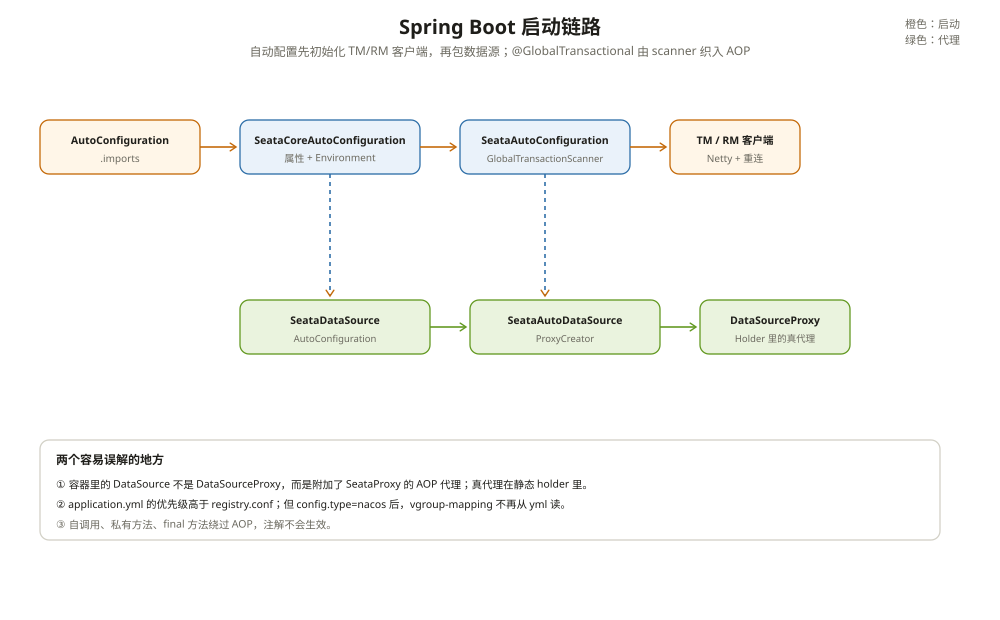

# Spring Boot 集成

Seata 接进 Spring Boot，表面上看只是加一个 starter、配几个 `seata.*` 属性、在方法上写 `@GlobalTransactional`。真正发生的事情比这多：自动配置要初始化 TM/RM 客户端，数据源要被代理，`@GlobalTransactional` 要被织进 AOP 链，配置还要从 `application.yml` 和 `registry.conf` 两边读。

这一篇按启动顺序，把这条链接起来。

---

## 一、模块：一个 starter，两层自动配置

Seata 的 Spring Boot 依赖不是一个巨大的 jar，而是拆成几层：

| 模块 | 负责什么 |
| --- | --- |
| `spring/seata-spring-boot-starter` | starter 入口，放自动配置类和 `AutoConfiguration.imports` |
| `spring/seata-spring-autoconfigure/seata-spring-autoconfigure-core` | 核心自动配置、属性包、Environment 桥 |
| `spring/seata-spring-autoconfigure/seata-spring-autoconfigure-client` | client 属性（`SeataProperties`、TM/RM/undo）、Spring Fence |
| `spring/seata-spring` | 纯 Spring 能力：`GlobalTransactionScanner`、数据源 AOP |
| `integration-tx-api` | `@GlobalTransactional` 定义和拦截器 handler |

`starter` 的 `META-INF/spring/org.springframework.boot.autoconfigure.AutoConfiguration.imports` 列了四个类：

- `SeataCoreAutoConfiguration`
- `SeataAutoConfiguration`
- `SeataDataSourceAutoConfiguration`
- `SeataHttpAutoConfiguration`（按 Servlet 类型存在与否二选一）

同时保留了 `spring.factories`，兼容老版本 Boot。Boot 3 用的是同一套 starter + `AutoConfiguration.imports`，但构建基线仍是 Boot 2.7.18；这一点在依赖升级时很容易踩到。

---

## 二、启动：从自动配置到 TM/RM 客户端

启动顺序大致是：

```text
AutoConfiguration.imports
  → SeataCoreAutoConfiguration
    → 扫描属性包、注册 Environment 桥
  → SeataAutoConfiguration
    → @Bean GlobalTransactionScanner
      → afterPropertiesSet()
        → initClient()
          → TMClient.init()
          → RMClient.init()
  → SeataDataSourceAutoConfiguration
    → 注册数据源代理 creator
```

`SeataAutoConfiguration` 上有 `@ConditionalOnProperty(prefix = "seata", name = "enabled", matchIfMissing = true)`。也就是说，默认开启；设 `seata.enabled=false` 就整套不装配。

`GlobalTransactionScanner` 本身是一个 `AbstractAutoProxyCreator`。它在 `afterPropertiesSet()` 里先初始化 TM 客户端，再初始化 RM 客户端；两个客户端都会启动 Netty 连接和定时重连。初始化失败，应用启动就会失败——这是好事，别等到第一笔事务才发现 TC 连不上。

初始化失败，应用启动就会失败——这是好事，别等到第一笔事务才发现 TC 连不上。



---

## 三、属性：`seata.*` 和 `registry.conf` 谁优先

Spring Boot 侧最重要的属性类是 `SeataProperties`：

```yaml
seata:
  enabled: true
  application-id: order-service
  tx-service-group: my_tx_group
  enable-auto-data-source-proxy: true
  data-source-proxy-mode: AT   # 或 XA
  use-jdk-proxy: false
  scan-packages: com.example
  service:
    vgroup-mapping:
      my_tx_group: default
  registry:
    type: file
  config:
    type: file
```

`seata.tx-service-group` 是逻辑事务组名；`seata.service.vgroup-mapping.<group>` 把它映射到 TC 集群名。没配时，`ServiceProperties` 会注入一组默认值：`default_tx_group → default`、`my_test_tx_group → default`，grouplist 默认 `127.0.0.1:8091`。

真正把 `application.yml` 和 Seata 内部配置桥起来的是 `SpringBootConfigurationProvider`：

- Seata 内部读 `service.vgroupMapping.x`，它加 `seata.` 前缀，变成 `seata.service.vgroup-mapping.x`，再查 Spring Environment；
- 查不到时把驼峰转 kebab；
- 再查不到，用调用方默认值 / 属性对象字段默认值。

`SeataPropertiesLoader` 会把 `registry.conf` / `file.conf` 里 `config.`、`registry.`、`server.`、`store.`、`metrics.`、`transport.` 前缀的键整体加 `seata.`，放进一个叫 `seataOldConfig` 的 PropertySource，并且用 `addLast`。**所以 `application.yml` 的优先级更高，会覆盖 `registry.conf`。**

反过来，如果你把 `seata.config.type` 设成 `nacos`，Seata 会加载 Nacos 的 `Configuration`；这时 `application.yml` 里的 `seata.service.vgroup-mapping` 不再参与这个 Configuration 的读取。只有 `seata.config.type` / `seata.registry.type` 还能通过 `registry.conf` 代理读到 Spring 的值。这个边界在“本地 file 配置 + 线上 Nacos 配置”混用时很容易踩。

---

## 四、数据源代理：容器里的 DataSource 不是 DataSourceProxy

`SeataDataSourceAutoConfiguration` 在存在 `DataSource` bean 时注册数据源代理 creator。它有三个占位符表达式，用来处理“没有 DataSource”“多个 DataSource”“已经有代理”的情况，并且 `@AutoConfigureOrder(LOWEST_PRECEDENCE)`、`@AutoConfigureAfter(DataSourceAutoConfiguration)`，保证在数据源初始化之后执行。

`SeataAutoDataSourceProxyCreator` 继承 `AbstractAutoProxyCreator`：

- 只处理 `DataSource`，跳过 `AbstractRoutingDataSource`；
- 按 `seata.data-source-proxy-mode` 创建 `DataSourceProxy`（AT）或 `DataSourceProxyXA`（XA）；
- 把 `<原始 DataSource, 代理 DataSource>` 放进静态 `DataSourceProxyHolder`。

容器里的 `DataSource` bean 实际是一个附加了 `SeataProxy` 标记接口的 AOP 代理；真正的 `DataSourceProxy` 藏在 holder 里。`SeataAutoDataSourceProxyAdvice` 只在全局事务或全局锁上下文中，把方法调用转发给 holder 里的真代理。

这个设计的好处是：不破坏原有数据源的 bean 类型和注入关系；坏处是调试时容易迷惑——你看到的 `DataSource` 不是最终执行 SQL 的那个。

如果你用 `@EnableAutoDataSourceProxy`，是同一套 creator 的另一种注册方式；它和 Boot 自动配置不要重复开。

---

## 五、`@GlobalTransactional` 怎么被织进去

`GlobalTransactionScanner.wrapIfNecessary()`（`:307`）在 bean 初始化后判断要不要代理：

```text
DefaultInterfaceParser.parserInterfaceToProxy()
  → 找到注解解析器
    → 生成 AdapterSpringSeataInterceptor
      → 挂到 AOP advisor 链
```

没找到匹配的解析器，返回 null，不代理。`@GlobalTransactional` 的拦截最终进入 `GlobalTransactionalInterceptorHandler.doInvoke()`，由 `TransactionalTemplate` 执行 begin/commit/rollback。

自调用、私有方法、final 方法、没被 Spring 管理的 bean，都可能绕过代理。注解只是标记，代理才是入口。

---

## 六、踩坑清单

- `seata.enabled=false` 或没引 starter：`@GlobalTransactional` 完全没反应。
- 只配了 `registry.conf`，又在 `application.yml` 里配了同名项：后者覆盖前者，别以为文件配置一定生效。
- `seata.config.type=nacos` 后还在 `application.yml` 里配 `vgroup-mapping`：这个 Configuration 读不到，得配到 Nacos 里。
- 数据源是 `AbstractRoutingDataSource`：自动代理会跳过，需要手动包代理。
- 容器里看到的是 `DataSource` AOP 代理，不是 `DataSourceProxy`：调试时看 holder 里的真代理。
- 同时用 `@EnableAutoDataSourceProxy` 和 Boot 自动配置：可能重复代理。
- 连接池初始 `autoCommit=false` 又选 XA：`ConnectionProxyXA.init()` 直接抛异常。
- 自调用带注解的方法：代理不生效，XID 不会出现。

---

## 附：这一章的源码入口

启动：

```text
AutoConfiguration.imports                            // starter:17
  → SeataCoreAutoConfiguration                        // :29
    → SeataPropertiesLoader                           // :52
  → SeataAutoConfiguration                            // :45
    → GlobalTransactionScanner                        // :56
      → initClient()                                  // :525
        → TMClient.init() / RMClient.init()           // :253 / :261
  → SeataDataSourceAutoConfiguration                  // :37
    → SeataAutoDataSourceProxyCreator                 // :35
```

属性桥：

```text
SpringBootConfigurationProvider.getConfig()
  → dataId 加 seata. 前缀                             // :177
  → Environment 查询
  → 驼峰转 kebab                                      // :227
  → 默认值回退                                        // :93
```

| 本文结论 | 源码证据 | 照搬之前先确认 |
| --- | --- | --- |
| starter 用 `AutoConfiguration.imports` 装配四个类 | `.../AutoConfiguration.imports:17` | 你的 Boot 版本是否读 imports |
| `application.yml` 覆盖 `registry.conf` | `SeataPropertiesLoader.java:82` | 你是否把远端配置和本地配置混用 |
| 数据源是 AOP 代理，真代理在 holder | `SeataAutoDataSourceProxyCreator.java:88`、`Advice:63` | 你的调试/监控是否看错了对象 |
| `@GlobalTransactional` 靠 scanner 代理 | `GlobalTransactionScanner.java:307` | 是否存在自调用/私有方法 |
| 默认开启，`seata.enabled=false` 关闭 | `SeataAutoConfiguration.java:45` | 你的环境是否误关 |

入口清单：

- `spring/seata-spring-boot-starter/src/main/java/org/apache/seata/spring/boot/autoconfigure/SeataAutoConfiguration.java`：`GlobalTransactionScanner` bean（`:56`）
- `spring/seata-spring-boot-starter/src/main/java/org/apache/seata/spring/boot/autoconfigure/SeataDataSourceAutoConfiguration.java`：数据源自动配置（`:37`）
- `spring/seata-spring-boot-starter/src/main/resources/META-INF/spring/org.springframework.boot.autoconfigure.AutoConfiguration.imports`：四个自动配置类（`:17`）
- `spring/seata-spring-autoconfigure/seata-spring-autoconfigure-core/src/main/java/org/apache/seata/spring/boot/autoconfigure/SeataCoreAutoConfiguration.java`：核心配置（`:29`）
- `spring/seata-spring-autoconfigure/seata-spring-autoconfigure-client/src/main/java/org/apache/seata/spring/boot/autoconfigure/properties/SeataProperties.java`：属性（`:26`）
- `spring/seata-spring-autoconfigure/seata-spring-autoconfigure-core/src/main/java/org/apache/seata/spring/boot/autoconfigure/loader/SeataPropertiesLoader.java`：旧配置桥（`:52`）
- `spring/seata-spring/src/main/java/org/apache/seata/spring/annotation/GlobalTransactionScanner.java`：`wrapIfNecessary()`（`:307`）、`initClient()`（`:525`）
- `spring/seata-spring/src/main/java/org/apache/seata/spring/annotation/datasource/SeataAutoDataSourceProxyCreator.java`：creator（`:35`）、holder（`:88`）
- `spring/seata-spring/src/main/java/org/apache/seata/spring/annotation/datasource/SeataAutoDataSourceProxyAdvice.java`：上下文分发（`:63`）
- `spring/seata-spring/src/main/java/org/apache/seata/spring/annotation/datasource/EnableAutoDataSourceProxy.java`：手动开启（`:30`）

---

## 思考题

1. `application.yml` 和 `registry.conf` 同时配了 `service.vgroupMapping`，哪个生效？为什么？
2. `seata.config.type=nacos` 后，`application.yml` 里的 `seata.service.vgroup-mapping` 还能被 Seata 读到吗？
3. 容器里的 `DataSource` 为什么不是 `DataSourceProxy`？SQL 最终由谁执行？
4. 一个 bean 自己调用自己的 `@GlobalTransactional` 方法，为什么事务不生效？应该怎么改？
