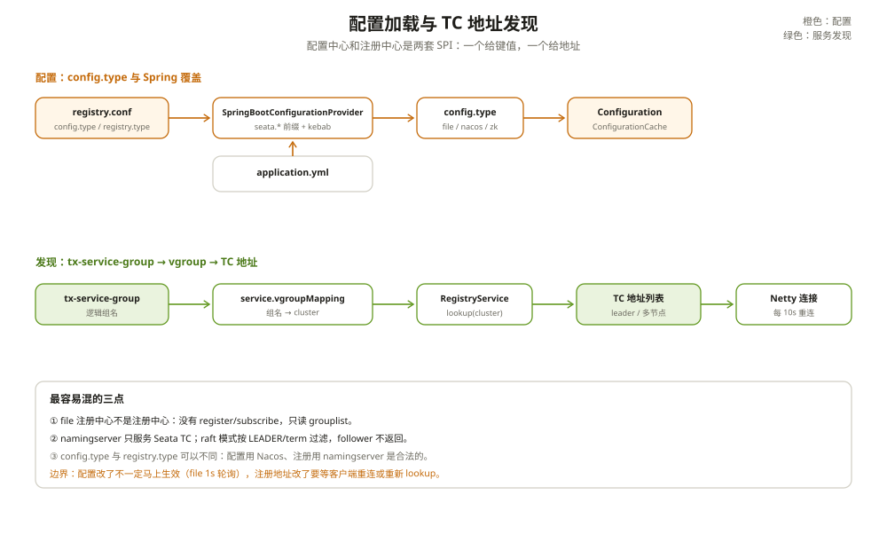

# 配置中心支持

Seata 有两套「外部系统」要接：配置中心和注册中心。

很多人把它们混在一起说，代码里也是两套独立的 SPI。配置中心解决「TC 地址、事务组、存储模式这些配置从哪来」；注册中心解决「TC 在哪个 IP:PORT」。一个挂了，另一个不一定挂。

这一篇只讲配置中心。注册中心在 [服务发现可插拔化](./03-服务发现.md)。

---

## 一、两套 SPI，别混

配置中心的入口是 `ConfigurationFactory`，它返回一个 `Configuration`。注册中心的入口是 `RegistryFactory`，它返回一个 `RegistryService`。

配置中心关心的是键值对：

```text
service.vgroupMapping.my_tx_group=default
client.rm.lock.retryTimes=30
store.session.mode=raft
```

注册中心关心的是地址列表：

```text
default -> 10.0.0.1:8091, 10.0.0.2:8091
```

`seata.config.type` 选配置实现，`seata.registry.type` 选注册实现。两个 type 可以不同：配置用 Nacos，注册用 seata namingserver，完全合法。

---

## 二、ConfigurationFactory 的加载顺序

`ConfigurationFactory` 是 final 类，加载顺序比较绕：

```text
1. 静态块 new FileConfiguration("registry", false)   // 读 registry.conf
2. load() 用 ExtConfigurationProvider 包成代理
3. getInstance() → buildConfiguration()
4. 读 config.type（经 Spring 代理变成 seata.config.type）
5. file → 加载 config.file.name（默认 file.conf）
   非 file → 按类型名 SPI 加载远端实现
6. 统一套 ConfigurationCache
```

第 1 步读的是 `registry.conf`，文件名可以被 `seata.config.name` / `SEATA_CONFIG_NAME` / `seataEnv` 改写。这个文件里既有 `registry { type = ... }`，也有 `config { type = ... }`。

第 2 步的 `ExtConfigurationProvider` 是 Spring 的桥。它把 `Configuration` 包成 CGLIB 代理，读某个 key 时先按 `seata.` 前缀查 Spring Environment，查不到再回退到原 Configuration。这样 `application.yml` 才能覆盖 `registry.conf`。

第 4 步读 `config.type`，经过代理就变成了 `seata.config.type`。所以你在 `application.yml` 里写 `seata.config.type=nacos`，会覆盖 `registry.conf` 里的 `config.type=file`。

第 5 步分叉：

- `file`：加载 `config.file.name`（默认 `file.conf`），再用 Spring 代理包一层；
- 非 `file`：`getNonSpringConfiguration()` 按类型名 SPI 加载 Nacos/ZK/Apollo/Consul/Etcd3/SpringCloudConfig/Custom。

第 6 步统一套 `ConfigurationCache`，第一次读某个 key 时自动注册监听，后续读走缓存。

第 6 步统一套 `ConfigurationCache`，第一次读某个 key 时自动注册监听，后续读走缓存。



---

## 三、内置实现

| 类型 | 实现 | 说明 |
| --- | --- | --- |
| file | `FileConfiguration` | 本地文件，轮询变更 |
| zk | `ZookeeperConfiguration` | ZooKeeper 节点 |
| nacos | `NacosConfiguration` | Nacos configService |
| apollo | `ApolloConfiguration` | Apollo |
| consul | `ConsulConfiguration` | Consul KV |
| etcd3 | `EtcdConfiguration` | etcd v3 |
| springcloud | `SpringCloudConfigConfiguration` | Spring Cloud Config |
| custom | `CustomConfiguration` | 自定义 |

**没有 Redis 配置中心。** `ConfigType` 枚举里没有 Redis，`config/` 目录也没有 redis 子模块。别把 Seata 的 redis 会话存储和 redis 配置中心搞混。

所有远端实现都通过 `META-INF/services/org.apache.seata.config.ConfigurationProvider` 注册，用 `@LoadLevel(name=...)` 标类型名。要接自研配置中心，实现 `ConfigurationProvider` + `Configuration` 两个接口，注册 SPI 即可。

---

## 四、Spring 的桥：优先级和边界

`SpringBootConfigurationProvider` 做的转换是：

```text
Seata 内部 key: service.vgroupMapping.my_tx_group
  → 加前缀: seata.service.vgroupMapping.my_tx_group
  → 驼峰转 kebab: seata.service.vgroup-mapping.my_tx_group
  → 查 Environment
```

查不到时，先回退调用方给的默认值，再回退属性对象字段的默认值。

`SeataPropertiesLoader` 则把 `registry.conf` / `file.conf` 里的键整体加 `seata.` 前缀，放进 `seataOldConfig` PropertySource，并且用 `addLast`。这意味着 **`application.yml` 的优先级更高**，会覆盖 `registry.conf` 的同名项。

这里有一个很容易踩的边界：`SpringBootConfigurationProvider` 只包裹 `ORIGIN_FILE_INSTANCE`，而它只在 `config.type=file` 时创建。一旦你把 `seata.config.type` 设成 `nacos`，返回的是 `NacosConfiguration`，`application.yml` 里的 `seata.service.vgroup-mapping` 就不再参与这个 Configuration 的读取。

只有 `seata.config.type` / `seata.registry.type` 还能通过 `registry.conf` 代理读到 Spring 的值。所以「本地用 application.yml，线上用 Nacos」这种混搭，要确认哪些键在哪个 Configuration 里。

---

## 五、动态刷新

配置中心的变更要能通知到 Seata。两条路径：

**file**：`FileListener` 每 1 秒比较 dataId 的值，值变了就派发 `ConfigurationChangeEvent`；同时按文件 `lastModified` 重载。它不是文件系统 watcher，是轮询。

**Nacos**：用原生 `configService.addListener`，服务端推送。

监听器侧：

- `ConfigurationChangeListener` 用线程池异步执行 `onProcessEvent`；
- `CachedConfigurationChangeListener` 在事件前先刷 `ConfigurationCache`；
- `ConfigurationCache` 对 `getXxx` 做 JDK 代理，第一次读取时自动注册监听。

所以「改了配置马上生效」取决于实现：file 最多延迟 1 秒，Nacos 取决于推送；已经缓存的值在事件到达后才刷新。

---

## 六、踩坑清单

- 把配置中心和注册中心当成一个东西：`config.type` 和 `registry.type` 是两套 SPI。
- 以为 `application.yml` 一定覆盖 `registry.conf`：file 模式下是，非 file 模式下 `vgroup-mapping` 不一定。
- 在 `application.yml` 配了 `seata.config.type=nacos`，又把 `vgroup-mapping` 只写在 yml 里：Nacos Configuration 读不到。
- 以为 file 配置是实时监听：它是 1 秒轮询。
- 把 Redis 当配置中心：Seata 没有 redis config 实现。
- 自定义配置中心只实现 `Configuration`，没注册 `ConfigurationProvider`：SPI 找不到。
- 改完配置没触发缓存刷新：看监听器有没有挂上，或者事件有没有派发。

---

## 附：这一章的源码入口

加载：

```text
ConfigurationFactory 静态块
  → new FileConfiguration("registry")                  // :61
ConfigurationFactory.load()
  → ExtConfigurationProvider 包 CGLIB 代理             // :67
ConfigurationFactory.getInstance()
  → buildConfiguration()                               // :121
    → getConfigType()                                  // :147
    → file: config.file.name                           // :132
    → 非 file: SPI 加载                                // :206
    → ConfigurationCache 包装                          // :171
```

Spring 桥：

```text
SpringBootConfigurationProvider.getConfig()
  → 加 seata. 前缀                                     // :177
  → Environment 查询
  → 驼峰转 kebab                                       // :227
```

| 本文结论 | 源码证据 | 照搬之前先确认 |
| --- | --- | --- |
| 配置与注册是两套 SPI | `ConfigurationFactory.java:43`、`RegistryFactory.java:44` | 你的 type 配置是否写到了正确的前缀 |
| file 模式由 `FileConfiguration` 读 `file.conf` | `ConfigurationFactory.java:132` | 你的 `file.conf` 是否随包发布 |
| 非 file 模式走 SPI | `ConfigurationFactory.java:206` | 你的配置实现是否注册了 SPI |
| yml 覆盖 registry.conf（file 模式） | `SeataPropertiesLoader.java:82` | 线上是否改用 Nacos，导致覆盖关系变化 |
| file 是 1 秒轮询 | `FileConfiguration.java:62`、`:383` | 你是否期待毫秒级生效 |
| 没有 Redis 配置中心 | `ConfigType.java:23` | 你是否把 redis 会话存储当配置中心 |

入口清单：

- `config/seata-config-core/src/main/java/org/apache/seata/config/ConfigurationFactory.java`：静态加载（`:61`）、`load()`（`:67`）、`buildConfiguration()`（`:121`）、`getConfigType()`（`:147`）、file/非 file（`:132` / `:206`）
- `config/seata-config-core/src/main/java/org/apache/seata/config/ConfigurationProvider.java`：SPI 接口（`:22`）
- `config/seata-config-core/src/main/java/org/apache/seata/config/ConfigType.java`：类型枚举（`:23`）
- `config/seata-config-core/src/main/java/org/apache/seata/config/ConfigurationChangeListener.java`：监听器（`:71`）
- `config/seata-config-core/src/main/java/org/apache/seata/config/ConfigurationCache.java`：缓存代理（`:74`）
- `config/seata-config-file/src/main/java/org/apache/seata/config/file/FileConfiguration.java`：轮询（`:62`）、重载（`:314`）
- `config/seata-config-nacos/src/main/java/org/apache/seata/config/nacos/NacosConfiguration.java`：Nacos 监听（`:157`）
- `spring/seata-spring-autoconfigure/seata-spring-autoconfigure-core/src/main/java/org/apache/seata/spring/boot/autoconfigure/provider/SpringBootConfigurationProvider.java`：Spring 桥（`:177`）
- `spring/seata-spring-autoconfigure/seata-spring-autoconfigure-core/src/main/java/org/apache/seata/spring/boot/autoconfigure/loader/SeataPropertiesLoader.java`：旧配置注入（`:52`）

---

## 思考题

1. `seata.config.type` 和 `seata.registry.type` 分别控制什么？它们可以一个用 Nacos、一个用 file 吗？
2. 为什么 `seata.config.type=nacos` 后，`application.yml` 里的 `seata.service.vgroup-mapping` 可能不生效？
3. file 配置的「动态刷新」延迟来自哪里？Nacos 的延迟又来自哪里？
4. 自研配置中心需要实现哪些接口、注册哪个 SPI？只实现 `Configuration` 够不够？
