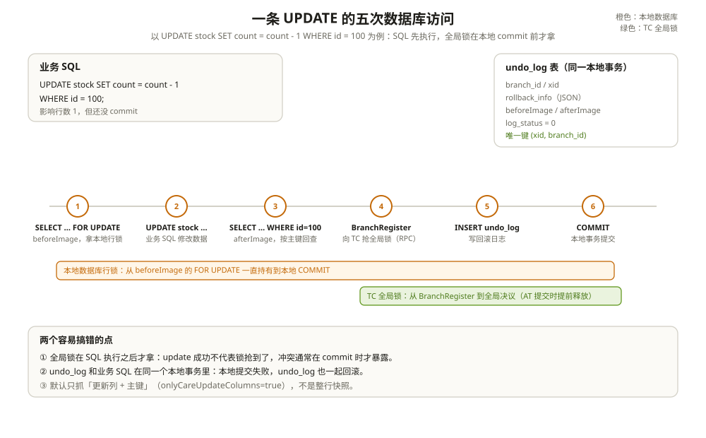

# AT 模式：自动补偿

AT 是 Seata 里用得最多、也最容易被误解的模式。

它看起来像「加个注解就完事」：业务代码还是那几条 SQL，回滚却自动发生了。但 AT 不是数据库事务，也不是把几个库包成一个大事务。它做的事是：**让每个本地事务正常提交，同时留一份前后镜像和一把全局锁；全局失败时，用镜像把已经提交的数据反向改回去。**

一阶段已经提交，二阶段再补偿。这两个事实决定了 AT 的所有优点和所有坑。

---

## 一、AT 的边界：它到底包住了什么

先看一条最普通的 UPDATE：

```sql
UPDATE stock SET count = count - 1 WHERE id = 100;
```

在 AT 里，它不是一个 SQL 的事，而是一串动作：

```text
SELECT ... FOR UPDATE      // beforeImage，拿本地行锁
UPDATE stock ...           // 业务 SQL
SELECT ... WHERE id = 100  // afterImage，按主键回查
BranchRegister             // 向 TC 抢全局锁
INSERT INTO undo_log ...   // 写回滚日志
COMMIT                     // 本地事务提交
```

这串动作里，真正让业务线程停下来等的是「BranchRegister + 抢全局锁」，不是 SQL 本身。SQL 早就执行完了，冲突通常在 commit 前才暴露。

AT 的「自动」来自两个东西：

- **镜像**：beforeImage / afterImage 记录了数据改前改后的样子；
- **全局锁**：TC 侧的一把行锁，防止两个全局事务在「本地已提交、全局未决议」的窗口里互相覆盖。

没有镜像，回滚没有素材；没有全局锁，两个 AT 事务的提交窗口会重叠。两者缺一不可。



---

## 二、一阶段：SQL 怎么被看见

业务代码拿到的 `DataSource` 不是驱动给的那个，而是 `DataSourceProxy`。从它开始，一路都是代理：

```text
DataSourceProxy.getConnection()                 // :211
  → ConnectionProxy
    → StatementProxy / PreparedStatementProxy
      → ExecuteTemplate.execute()               // :78
        → SQLVisitorFactory.get(sql, dbType)    // Druid 解析
          → UpdateExecutor / InsertExecutor / DeleteExecutor
```

`ExecuteTemplate` 第一行就分流：

```java
if (!RootContext.requireGlobalLock() && BranchType.AT != RootContext.getBranchType()) {
    return statementCallback.execute(statementProxy.getTargetStatement(), args);
}
```

不在全局事务里，也没有 `@GlobalLock`，SQL 直接走原生 Statement。代理装上了，不代表每条 SQL 都会被 Seata 接管。

解析成功，按 SQL 类型选执行器；解析失败，不是静默降级，而是把 `ParserException` 包成 `SQLException` 抛出。真正会静默放行的是「识别器为 null」的普通 SELECT、DDL——它们走 `PlainExecutor`，不生成镜像、不注册分支。这一点在 [SQL 解析与重写](../sql/01-SQL解析与重写.md) 里展开。

---

## 三、镜像不是整行快照

拿这条 SQL 举例：

```sql
UPDATE stock SET count = count - 1 WHERE id = 100;
```

Seata 在业务 SQL 前后各做一次查询：

```text
beforeImage:
SELECT id, count FROM stock WHERE id = 100 FOR UPDATE;
-- (100, 10)

业务 SQL:
UPDATE stock SET count = count - 1 WHERE id = 100;

afterImage:
SELECT id, count FROM stock WHERE id = 100;
-- (100, 9)
```

这里有一个很多人以为是「整行快照」的地方：**默认只抓被更新的列和主键**。`client.undo.onlyCareUpdateColumns` 默认是 `true`，所以上面只查了 `id` 和 `count`，不会把 `stock` 表的 `version`、`updated_at`、`warehouse_id` 一起拍下来。

这个默认值是有意的。整行快照会让 undo log 变大，回滚时还会把别人改过的列一起覆盖回去。只抓参与本次更新的列，undo SQL 就只还原这几列，副作用小。

代价是：**undo log 不是一份完整的行备份。** 如果一条 SQL 更新了 `count`，另一个不走 Seata 的进程同时改了 `status`，回滚只会把 `count` 改回去，`status` 保持后者写入的值。

三种 SQL 的镜像规则不一样：

| SQL | beforeImage | afterImage | 锁键取自 |
| --- | --- | --- | --- |
| UPDATE | 按 WHERE 条件查，带 `FOR UPDATE`，取更新列 + 主键 | 按主键回查，取同样的列 | afterImage |
| DELETE | 按 WHERE 条件查，带 `FOR UPDATE`，取所有列 | 空 | beforeImage |
| INSERT | 空 | 按主键回查插入列 + 主键 | afterImage |

UPDATE 和 DELETE 的 beforeImage 都带 `FOR UPDATE`，这不是为了全局锁，而是为了拿住本地数据库的行锁，防止在「查镜像」和「改数据」之间被别的本地事务插进来。这个本地锁会一直持有到本地事务提交。

INSERT 没有 beforeImage，因为插入前那一行不存在。它的主键从哪来？SQL 里写了就用 SQL 里的值；自增主键靠 JDBC 返回的 generated keys。拿不到主键，afterImage 就建不出来，这条 INSERT 没法回滚。**AT 的表必须有主键**，不是建议，是硬要求。

---

## 四、一阶段的严格顺序

一条 UPDATE 在 AT 里，是五次数据库访问加一次 RPC：

```text
1. SELECT ... FOR UPDATE        // beforeImage，拿本地行锁
2. UPDATE stock SET ...         // 业务 SQL
3. SELECT ... WHERE id = 100    // afterImage，按主键回查
4. RPC: BranchRegister          // 向 TC 抢全局锁（在本地 commit 之前）
5. INSERT INTO undo_log ...     // 写回滚日志（同一个本地事务）
6. COMMIT                       // 本地事务提交，数据对外可见
```

第 1 到第 3 步在 `AbstractDMLBaseExecutor.executeAutoCommitFalse()`（`:97`）里完成：先 `beforeImage()`，再 `statementCallback.execute()`，再 `afterImage()`，最后 `prepareUndoLog()`。这时候 undo log 还只在内存里，没写库。

第 4 步到第 6 步在 `ConnectionProxy.processGlobalTransactionCommit()`（`:247`）：

```java
private void processGlobalTransactionCommit() throws SQLException {
    try {
        register();                                  // 向 TC 注册分支、抢全局锁
    } catch (TransactionException e) {
        recognizeLockKeyConflictException(e, context.buildLockKeys());
    }
    try {
        UndoLogManagerFactory.getUndoLogManager(this.getDbType()).flushUndoLogs(this);
        targetConnection.commit();                   // 本地提交
    } catch (Throwable ex) {
        report(false);
        throw new SQLException(ex);
    }
    if (IS_REPORT_SUCCESS_ENABLE) {
        report(true);                                // 上报 PhaseOne_Done
    }
}
```

顺序是死的：**先注册分支和抢全局锁，再写 undo log，再本地提交，最后上报。** 这四步里任何一步失败，处理方式都不一样：

- 抢锁失败：`LockConflictException`，按 `client.rm.lock.retryTimes` / `retryInterval` 重试，默认 30 次、10 毫秒一次；
- 写 undo log 失败：本地事务回滚，向 TC 上报 `PhaseOne_Failed`；
- 本地提交失败：同上，数据没提交，undo log 也随本地事务回滚；
- 上报失败：数据已经提交了，TC 那边还认为分支是 `Registered`。这时要靠 TC 的超时扫描或后续重试把状态补上。

第 6 步之后，数据对其他会话可见。全局事务还没结束，但 AT 的一阶段已经做完了。

---

## 五、分支为什么在 commit 时才注册

这是 AT 和 TCC 的一个分叉点。

TCC 在 try 之前就注册分支：框架要先让 TC 知道「这个参与者准备干活了」，confirm/cancel 才有对象。Saga 默认连每个 state 的分支都不注册。AT 选择在本地提交前才注册，原因有两个。

第一，AT 要收集锁键。一条业务方法里可能执行了十几条 SQL，分布在同一张表的不同行上。如果每条 SQL 都发一次 `BranchRegisterRequest`，网络开销不说，TC 的锁表也要被写十几次。Seata 的做法是在 `ConnectionContext` 里按 Savepoint 攒锁键，提交前 `buildLockKeys()` 一次性去重、拼成一个字符串，发一次 RPC。

锁键长这样：

```text
stock:100
stock:100,101,102
order_item:1_a,2_b          // 复合主键用 _ 连接
```

同一个资源、不同表的锁键用 `;` 拼起来。TC 收到之后按行拆开，逐行去抢。

第二，AT 的锁是「提交锁」，不是「执行锁」。它要保护的是「本地事务提交」和「全局事务决议」之间的窗口，不是 SQL 执行本身。放到提交前拿，锁的持有时间最短。

这也解释了一个常见现象：两个全局事务并发更新同一行，后一个的 update 语句可能也会成功，因为本地数据库的行锁会先让它们排队；真正报错的是后一个的 `commit()`。如果后一个用的是自动提交模式，Seata 会把它改成手动提交，在 `executeAutoCommitTrue()` 里把「执行 + 提交」包在锁重试策略里。

---

## 六、全局锁与隔离

TC 侧的锁不是数据库锁，它锁的是一个字符串：`资源 ID + 表名 + 主键`。

file 模式下，`FileLocker` 的结构是：

```text
resourceId → tableName → 128 个 bucket → pk → 持有锁的 BranchSession
```

每个分支持有一个 `lockHolder`，记录自己拿过哪些 bucket 里的哪些 pk。抢锁时逐行 `putIfAbsent`；只要有一行被别人占了，就把这个分支本次已经拿到的锁全部释放，返回失败。这个「整批释放」很重要：它避免了半个分支持锁、半个分支不持锁的中间状态。

db 模式下，这把锁落在 `lock_table` 里；redis 模式下落在 `SEATA_GLOBAL_LOCK*` 系列 key 上；raft 模式下，锁在 leader 本地，释放通过 raft 任务复制。

但不管哪种存储，它都只拦得住**同样来抢这把锁的 Seata 写操作**。一条不走代理的 SQL、一个直连数据库的脚本、一个没有 `DataSourceProxy` 的数据源，都能直接改这行数据。

那怎么保证读到的数据不是别人一阶段提交、随后又回滚的脏数据？Seata 的默认隔离级别是读未提交。要在 AT 里拿到接近读已提交的行为，得在事务开始时用代理执行 `SELECT ... FOR UPDATE`，把要改的行先查一遍。`SelectForUpdateExecutor` 会在拿到本地行锁之后，向 TC 查一次全局锁：

- 如果别人持有全局锁，释放本地锁、睡一会、重查；
- 如果没人持有，继续往下走。

这样读到的数据，要么是对方已经全局提交的，要么是对方已经回滚完的，不会读到一个「稍后会被回滚」的中间值。代价是每条要改的行多一次 `SELECT ... FOR UPDATE` 和一次 TC 查询。

`@GlobalLock` 是这条路的轻量版：只查全局锁，不注册分支、不写 undo log，适合「我要读一下这行，确认没有全局事务正在改它」的场景。

---

## 七、二阶段提交：先返回，后收尾

TM 发来 `GlobalCommitRequest` 之后，`DefaultCore.commit()`（`:237`）做的第一件事不是给各分支发提交请求，而是看这个全局会话能不能异步提交。

AT 分支的 `canBeCommittedAsync()` 恒为 `true`。于是 TC 把全局会话状态改成 `AsyncCommitting`，调 `clean()` 释放全局锁，直接向 TM 返回 `Committed`。`GlobalStatus` 里对这个状态的注释写得很清楚：提交还没做完，但对 TM/RM 客户端可以视为已提交。

真正的分支提交，是后台线程每秒扫一次 `AsyncCommitting` 会话，再逐个分支发 `BranchCommitRequest`。RM 收到后，`AsyncWorker.branchCommit()` 只做一件事：把 `(xid, branchId, resourceId)` 塞进 `commitQueue`，然后立刻返回 `PhaseTwo_Committed`。

TC 收到 `PhaseTwo_Committed`，就把这个分支从会话里删掉。全局会话的分支清空后，`endCommitted()` 把状态改成 `Committed`。

而 undo log 还没删。它由 `AsyncWorker` 的另一个定时任务处理，默认每秒跑一次，每次最多删 1000 条。队列容量默认 10000，满了就紧急清一次再重试入队。

所以「提交成功」的完整语义是：

- TC：这笔全局事务不会再回滚，会话状态已经落定；
- RM：分支的本地事务早就提交了，undo log 的删除只是清理工作，晚一点没关系。


---

## 八、二阶段回滚：逆序、回放、对账

回滚的路径完全相反。TC 不能先返回，因为回滚要改数据，改不干净就是不一致。

`DefaultCore.rollback()` 先把会话 `close()`，阻止新分支注册，然后把状态改成 `Rollbacking`，再调 `doGlobalRollback()`。分支列表用 `getReverseSortedBranches()` 取反序，从最后一个注册的分支开始回滚。

每个分支发一条 `BranchRollbackRequest`，RM 侧进入 `AbstractUndoLogManager.undo()`。整个过程在一个本地事务里完成：

```text
1. 开本地事务（autoCommit=false）
2. SELECT * FROM undo_log WHERE branch_id=? AND xid=? FOR UPDATE
3. 如果 log_status 不是 Normal(0)，直接返回
4. 解码 rollback_info，取出 BranchUndoLog
5. 如果有多条 SQLUndoLog，Collections.reverse()
6. 逐条生成反向 SQL 并执行
7. 删除这条 undo_log
8. 提交本地事务
```

第 5 步的逆序是另一层逆序。一个分支里可能有多条 SQL，比如先 INSERT 订单、再 UPDATE 库存。BranchUndoLog 里按执行顺序存着这些 SQL 的镜像，回滚时必须反过来：先撤库存，再删订单。

第 6 步生成的反向 SQL 分三种：

| 原 SQL | 反向 SQL | 用的是哪份镜像 |
| --- | --- | --- |
| UPDATE | `UPDATE 表 SET 非主键列 = beforeImage WHERE 主键 = ?` | beforeImage |
| DELETE | `INSERT INTO 表 (所有列) VALUES (beforeImage)` | beforeImage |
| INSERT | `DELETE FROM 表 WHERE 主键 = afterImage` | afterImage |

回滚前会做三方对账：`beforeImage`、`afterImage`、`currentRecords`。

| 条件 | 判断 | 动作 |
| --- | --- | --- |
| before == after | 一阶段根本没改数据 | 跳过回滚 |
| current == after | 数据还是一阶段改完的样子 | 正常回滚 |
| current == before | 已经被别人回滚过了 | 跳过回滚 |
| 其他 | 数据被第三方改过 | 抛 `SQLUndoDirtyException`，回滚不可重试 |

最后一种就是脏写。Seata 选择停下来，报 `BranchRollbackFailed_Unretriable`，让人工介入。默认校验开启（`client.undo.dataValidation=true`）；关掉它，回滚会更快，但脏写会被静默覆盖。

---

## 九、回滚比一阶段先到：一条墓碑记录

考虑这个时序：

1. 分支的本地事务还在执行，undo log 还没写；
2. 全局事务超时，TC 开始回滚；
3. TC 给这个分支发 `BranchRollbackRequest`；
4. RM 去查 undo log，什么也没查到；
5. 分支随后执行完，准备写 undo log 并提交本地事务。

如果第 4 步什么都不做，第 5 步就会把一个已经决定回滚的分支提交掉。Seata 的处理是：查不到 undo log 时，插入一条 `log_status = GlobalFinished(1)` 的墓碑记录，然后提交。这个记录的 `(xid, branch_id)` 和正常 undo log 相同，受唯一键约束。等第 5 步的分支来写 undo log 时，INSERT 撞唯一键，本地事务失败，分支回滚。

所以「回滚了但 undo_log 表里查不到」是正常的：墓碑记录可能已经被清理，或者这次回滚根本没有走到写日志那一步。

---

## 十、失败之后：提交可以慢慢来，回滚不能

**提交失败**：TC 把全局会话改成 `CommitRetrying`，每秒重试一次。`server.maxCommitRetryTimeout` 默认是 `-1`，也就是不设上限，一直试。分支的提交是幂等的，重试没有副作用。

**回滚失败**：分两种。

- 可重试失败：数据库连接断了、锁等待超时、undo log 暂时查不到。TC 每秒重试一次，`server.maxRollbackRetryTimeout` 默认也是 `-1`。
- 不可重试失败：脏写校验失败、反向 SQL 撞唯一约束、undo log 损坏。TC 把全局会话改成 `RollbackFailed`，停止重试。

回滚失败后，全局锁默认不释放（`server.rollbackFailedUnlockEnable=false`）。这意味着这行数据会一直挂在 TC 的锁表里，别的全局事务来抢锁会失败。这个行为是在保护数据：回滚没完成之前，不能让新事务改这行。

---

## 十一、踩坑清单

- 以为 update 成功就代表分支注册成功：注册发生在 commit 前，冲突也在 commit 前才暴露。
- 表没有主键，或者联合主键里包含可空列：镜像和锁键都建不起来。
- 用 `onlyCareUpdateColumns=false` 抓了整行，回滚时把别人改的列也覆盖回去。
- 以为 SQL 解析失败会静默降级：解析异常会抛 `SQLException`；真正静默放行的是普通 SELECT/DDL。
- 在全局事务里用 `SELECT ... FOR UPDATE` 却没走代理：本地锁拿到了，TC 的全局锁没查，脏读窗口还在。
- 以为全局锁能拦住所有并发写：不走 Seata 的写入可以直接穿过。
- 看到 TC 返回 `Committed` 就以为所有分支的 undo log 已删：AT 的提交是异步的。
- 回滚日志里出现 `GlobalFinished` 就以为数据坏了：那是防止一阶段后到的墓碑记录。
- 手工清 undo_log 或手工放锁，却不校准数据：下一次重试会把错误的数据再写一遍。

---

## 附：这一章的源码入口

一阶段：

```text
ExecuteTemplate.execute()                             :78
  → SQLVisitorFactory.get()                           // Druid 解析
    → UpdateExecutor
      → beforeImage()                                 // SELECT ... FOR UPDATE
      → statementCallback.execute()                   // 业务 SQL
      → afterImage()                                  // SELECT ... WHERE pk
      → prepareUndoLog()                              // 仅入内存
ConnectionProxy.commit()                              :185
  → processGlobalTransactionCommit()                  :247
    → register()                                      :267（BranchRegister RPC）
    → flushUndoLogs()                                 :254（INSERT undo_log）
    → targetConnection.commit()                       :255
    → report(true)                                    :311（PhaseOne_Done）
```

二阶段提交：

```text
DefaultCore.commit()                                  :237
  → asyncCommit()                                     :255
  → clean()                                           :262（释放全局锁）
  → 返回 Committed                                     :277
DefaultCoordinator.handleAsyncCommitting()            :524（每秒）
  → DefaultCore.doGlobalCommit()                      :284
    → AbstractCore.branchCommit()                     :196
      → AsyncWorker.branchCommit()                    :78（入队即返回）
        → 定时 deleteUndoLog()                        :169
```

二阶段回滚：

```text
DefaultCore.rollback()                                :401
  → DefaultCore.doGlobalRollback()                    :424
    → getReverseSortedBranches()
      → AbstractUndoLogManager.undo()                 :315
        → SELECT undo_log ... FOR UPDATE              :89
        → Collections.reverse(sqlUndoLogs)            :368
        → AbstractUndoExecutor.executeOn()            :114
          → dataValidationAndGoOn()                   :234
        → deleteUndoLog / insert GlobalFinished       :399
```

| 本文结论 | 源码证据 | 照搬之前先确认 |
| --- | --- | --- |
| 镜像默认只抓更新列 + 主键 | `BaseTransactionalExecutor.getNeedColumns():570`、`DefaultValues.java:261` | 你的回滚是否依赖未更新列的恢复 |
| 业务 SQL 在全局锁之前执行 | `AbstractDMLBaseExecutor.executeAutoCommitFalse():97`、`ConnectionProxy.processGlobalTransactionCommit():247` | 你是否假设「update 报错就一定没改数据」 |
| 分支在本地 commit 前注册 | `ConnectionProxy.register():267` | 你的重试是否把 `LockKeyConflict` 当成 SQL 错误 |
| AT 提交先返回、后收尾 | `DefaultCore.commit():255`、`AsyncWorker.branchCommit():78` | 你的监控是否把 `Committed` 当成二阶段完成 |
| 回滚做三方对账，脏写不可重试 | `AbstractUndoExecutor.dataValidationAndGoOn():234` | 你是否关了 `client.undo.dataValidation` |
| 一阶段没写日志时插墓碑 | `AbstractUndoLogManager.undo():409` | 你的排障脚本是否把 `GlobalFinished` 当脏数据删掉 |

入口清单：

- `rm-datasource/src/main/java/org/apache/seata/rm/datasource/DataSourceProxy.java`：`getConnection()`（`:211`）
- `rm-datasource/src/main/java/org/apache/seata/rm/datasource/exec/ExecuteTemplate.java`：`execute()`（`:78`）、直通分支（`:84`）
- `rm-datasource/src/main/java/org/apache/seata/rm/datasource/exec/AbstractDMLBaseExecutor.java`：`doExecute()`（`:81`）、`executeAutoCommitFalse()`（`:97`）、`executeAutoCommitTrue()`（`:146`）
- `rm-datasource/src/main/java/org/apache/seata/rm/datasource/exec/UpdateExecutor.java`：`beforeImage()`（`:67`）、`afterImage()`（`:99`）
- `rm-datasource/src/main/java/org/apache/seata/rm/datasource/exec/BaseTransactionalExecutor.java`：`execute()`（`:124`）、`prepareUndoLog()`（`:404`）、`buildLockKey()`（`:443`）、`buildUndoItem()`（`:484`）、`getNeedColumns()`（`:570`）
- `rm-datasource/src/main/java/org/apache/seata/rm/datasource/ConnectionProxy.java`：`commit()`（`:185`）、`processGlobalTransactionCommit()`（`:247`）、`register()`（`:267`）
- `rm-datasource/src/main/java/org/apache/seata/rm/datasource/undo/AbstractUndoLogManager.java`：`flushUndoLogs()`（`:266`）、`SELECT ... FOR UPDATE`（`:89`）、`undo()`（`:315`）、逆序（`:368`）、墓碑（`:409`）
- `rm-datasource/src/main/java/org/apache/seata/rm/datasource/undo/AbstractUndoExecutor.java`：`executeOn()`（`:114`）、`dataValidationAndGoOn()`（`:234`）
- `rm-datasource/src/main/java/org/apache/seata/rm/datasource/undo/UndoExecutorFactory.java`：`getUndoExecutor()`（`:34`）
- `server/src/main/java/org/apache/seata/server/coordinator/DefaultCore.java`：`commit()`（`:237`）、`asyncCommit()`（`:255`）、`clean()`（`:262`）
- `server/src/main/java/org/apache/seata/server/coordinator/DefaultCoordinator.java`：`handleAsyncCommitting()`（`:524`）
- `common/src/main/java/org/apache/seata/common/DefaultValues.java`：`DEFAULT_ONLY_CARE_UPDATE_COLUMNS`（`:261`）、`DEFAULT_MAX_COMMIT_RETRY_TIMEOUT`（`:533`）、`DEFAULT_MAX_ROLLBACK_RETRY_TIMEOUT`（`:538`）、`DEFAULT_ROLLBACK_FAILED_UNLOCK_ENABLE`（`:543`）

---

## 思考题

1. 一条 UPDATE 更新了 3 行，undo log 里有几份行镜像？锁键里有几个主键？
2. 业务方法里先 `SELECT` 再 `UPDATE`，`SELECT` 没加 `FOR UPDATE`。另一个全局事务在两步之间改了同一行并回滚，你的 `UPDATE` 会读到什么？undo log 记的 beforeImage 是什么？
3. 为什么 AT 要求表必须有主键？如果没有主键，能不能用「所有列」当条件来替代？
4. TM 收到 `Committed` 后立刻重启，此时 undo log 还没删。这个全局事务还能继续完成吗？靠谁完成？
5. 回滚失败后默认不释放全局锁，这个行为保护了什么？如果业务要求「先让新事务跑起来」，应该改哪个配置，代价是什么？
