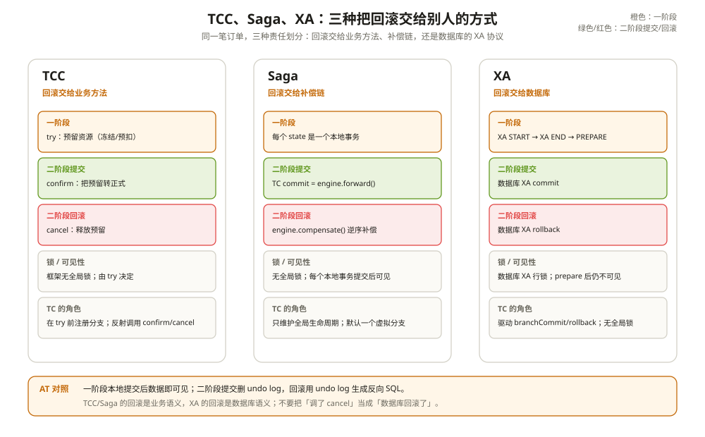

# TCC 模式：尝试-确认-取消

优惠券服务用了 TCC。

全局事务回滚时，`cancel` 先到了；过了一会儿，`try` 才执行完。`cancel` 把券从「已核销」改回「未使用」，`try` 又把券锁成了「冻结」。全局事务已经结束，这张券却卡在冻结状态，谁也动不了。

开发查了半天，说 cancel 和 try 都加了判断，怎么会这样。问题不在判断，在于顺序：**TCC 默认不处理「cancel 比 try 先到」这种情况。** 框架只负责在二阶段调你的方法，方法内部怎么保证幂等、空回滚、反悬挂，是业务自己的事。

AT 把回滚交给 undo log，Saga 交给补偿链，TCC 交给业务方法。三个方法的名字已经把责任写清楚了：try 预留，confirm 确认，cancel 撤销。

---

## 一、TCC 的三方法契约

一个典型的 TCC 接口：

```java
@LocalTCC
public interface CouponAction {
    @TwoPhaseBusinessAction(name = "couponAction",
            commitMethod = "confirm", rollbackMethod = "cancel")
    boolean try(BusinessActionContext ctx, Long couponId);

    boolean confirm(BusinessActionContext ctx);

    boolean cancel(BusinessActionContext ctx);
}
```

`@TwoPhaseBusinessAction` 的 `name` 是 `actionName`，也是 TC 侧的 `resourceId`。同一个应用里必须唯一；两个不同的 bean 用了同一个名字，启动时会直接报错。

try 负责预留资源：把券从 `AVAILABLE` 改成 `FROZEN`，或者冻结一部分余额。confirm 把预留转正式；cancel 释放预留。

和 AT 不同，TCC 的一阶段不是「执行业务 SQL + 本地提交」，而是「按业务语义预留资源」。预留的粒度、可见性、失败后的清理，全部由业务决定。

---

## 二、分支在 try 之前注册

TCC 的拦截器只看一眼当前上下文：

```java
if (!RootContext.inGlobalTransaction() || RootContext.inSagaBranch()) {
    return invocation.proceed();
}
```

不在全局事务里，或者当前是 Saga 分支，直接放行。否则绑定 TCC 分支类型，进入 `ActionInterceptorHandler`。

真正的分支注册发生在业务 try 执行之前：

```text
TccActionInterceptorHandler.doInvoke()                 // :66
  → ActionInterceptorHandler.proceed()                 // :87
    → doTxActionLogStore()                             // :267
      → DefaultResourceManager.branchRegister(TCC, actionName, ...) // :306
    → 执行业务 try
```

这个顺序和 AT 相反。AT 是先把 SQL 做完、本地提交前才注册；TCC 是先注册分支，再执行 try。因为 TCC 的二阶段没有 undo log 可查，TC 必须先知道这个分支存在，confirm/cancel 才有对象。

注册用的 `resourceId` 不是数据源，而是 `actionName`。`TCCResource` 在启动时由 `TccActionInterceptorParser` 扫描 `@TwoPhaseBusinessAction` 方法创建，保存 targetBean、commitMethod、rollbackMethod。

---

## 三、二阶段是本地方法调用

TC 发来 `BranchCommitRequest` 后，RM 侧 `TCCResourceManager` 从 `TCCResource` 里拿出 `targetBean` 和 `commitMethod`，反射调用：

```java
ret = commitMethod.invoke(targetTCCBean, args);
```

它不会通过 RPC 再调一次业务服务。如果这个 bean 本身是 Dubbo 引用，那反射调用会走到远程；如果它是本地 Spring bean，confirm 就在当前进程执行。**TCC 的「二阶段」不是一次网络协调，而是一次方法调用。**

返回值决定 TC 是否重试：

- `true` 或 `TwoPhaseResult.success`：`PhaseTwo_Committed` / `PhaseTwo_Rollbacked`；
- `false`：`PhaseTwo_CommitFailed_Retryable` / `PhaseTwo_RollbackFailed_Retryable`；
- 抛异常：同样返回可重试状态，TC 按回滚/提交重试策略再来一遍。

所以 confirm/cancel 必须是幂等的，或者至少能承受重复调用。TC 不会因为「上一次调用超时」就假设它没执行。

---

## 四、默认不处理幂等、空回滚和悬挂

`@TwoPhaseBusinessAction` 的 `useTCCFence` 默认是 `false`。不开 fence 时，`TCCResourceManager` 直接反射调用 cancel，不查任何状态表。

于是三种经典问题都要业务自己处理：

**空回滚**：try 还没执行，cancel 先到了。比如全局事务超时，TC 开始回滚，但 try 还在排队。cancel 收到的是一张还没冻结的券，它可能什么都不做，也可能误把一张正常券改坏。

**幂等**：TC 因为网络超时重发 cancel，cancel 被执行两次。如果 cancel 是「把冻结改成可用」，第二次执行时券已经是可用，可能又改出问题；如果 cancel 是「插入一条退款记录」，第二次会插两条。

**悬挂**：cancel 先执行完，try 后到。cancel 已经把资源释放了，try 又把资源锁住，全局事务却已经回滚。开头那个优惠券故障就是这种。

业务里常见的土办法是加状态机字段和唯一约束：cancel 只允许从 `FROZEN` 迁到 `AVAILABLE`，try 只允许从 `AVAILABLE` 迁到 `FROZEN`；再加一张 `(xid, branch_id)` 唯一表挡住重复。能做，但每个 TCC 接口都要写一遍。

---

## 五、fence：用一张状态表收掉三种问题

把 `useTCCFence` 打开，Seata 会在业务库里读写 `tcc_fence_log`：

```sql
CREATE TABLE tcc_fence_log (
  xid VARCHAR(128) NOT NULL,
  branch_id BIGINT NOT NULL,
  action_name VARCHAR(64) NOT NULL,
  status TINYINT NOT NULL,  -- 1 TRIED, 2 COMMITTED, 3 ROLLBACKED, 4 SUSPENDED
  gmt_create DATETIME(3) NOT NULL,
  gmt_modified DATETIME(3) NOT NULL,
  PRIMARY KEY (xid, branch_id)
);
```

状态只有四个：`TRIED`、`COMMITTED`、`ROLLBACKED`、`SUSPENDED`。fence 的所有行为都围绕这四个状态展开：

| 场景 | 表里已有状态 | fence 的动作 |
| --- | --- | --- |
| try 第一次执行 | 无 | 在同一本地事务里插入 `TRIED`，再执行业务 try |
| try 重复执行 | `TRIED` | 唯一键冲突，抛 `CommonFenceException`，阻止重复预留 |
| confirm 第一次 | `TRIED` | 执行业务 confirm，把状态改成 `COMMITTED` |
| confirm 重复 | `COMMITTED` | 直接返回 true，不重复执行 |
| cancel 第一次 | `TRIED` | 执行业务 cancel，改成 `ROLLBACKED` |
| cancel 重复 | `ROLLBACKED` / `SUSPENDED` | 直接返回 true |
| cancel 比 try 先到 | 无 | 插入 `SUSPENDED`，返回 true（空回滚） |
| try 在 cancel 之后到 | `SUSPENDED` | 插入 `TRIED` 撞唯一键，try 失败（反悬挂） |

关键在最后两行。cancel 先到又查不到记录时，fence 不执行任何业务逻辑，只插一条 `SUSPENDED` 作为墓碑；等 try 再来，唯一键把它挡在门外。这比「业务里判断券状态」可靠，因为它不依赖业务字段是否恰好能表达「曾经有一个 try 来过」。

fence 的代价也很明确：每次 try/confirm/cancel 都要多一次本地事务和一张表的读写；`SUSPENDED` 记录不会自动消失，需要配清理任务；它依赖 Spring 的数据源和事务模板，不是所有接入方式都能用。

---

## 六、TCC 和 AT / Saga / XA 的边界

| 维度 | TCC | AT | Saga | XA |
| --- | --- | --- | --- | --- |
| 一阶段 | try 预留 | SQL + 本地提交 | 每个 state 本地事务 | XA prepare |
| 回滚执行者 | cancel 方法 | undo log 反向 SQL | compensate 服务 | 数据库 XA rollback |
| 框架锁 | 无 TC 全局锁 | TC 全局锁 + 本地行锁 | 无 | 数据库 XA 行锁 |
| 数据可见性 | 由 try 决定 | 一阶段提交后可见 | 每个本地事务后可见 | XA commit 后可见 |
| 默认幂等/悬挂 | 业务自己兜 | 不需要 | 补偿自己兜 | 不需要 |

TCC 的优势是「资源怎么预留、怎么释放」完全由业务定义，适合券、余额、库存这类不能靠反向 SQL 简单还原的资源。代价是三个方法都要写，幂等、空回滚、悬挂都要考虑。



---

## 七、踩坑清单

- TCC 不开 fence，却假设框架会处理空回滚、幂等和悬挂：这三种情况默认全是业务责任。
- TCC 的 confirm/cancel 里做远程调用，却没做超时和重试：TC 重试会把远程调用放大。
- TCC 的 `actionName` 在不同 bean 上重复：启动时报错，或者 confirm 调到了错误的 bean。
- try 里做了资源预留，但没在 cancel 里检查「预留是否真的存在」：空回滚会把正常资源改坏。
- confirm/cancel 返回值不是 boolean，也不是 `TwoPhaseResult`：反射调用直接失败。
- 把 TCC 的分支当成有 TC 全局锁：TCC 的锁在业务资源里，TC 只负责调方法。

---

## 附：这一章的源码入口

一次 try：

```text
TccActionInterceptorHandler.doInvoke()                 :66
  → ActionInterceptorHandler.proceed()                 :87
    → doTxActionLogStore()                             :267
      → branchRegister(TCC, actionName, ...)           :306
    → 业务 try
```

一次二阶段：

```text
TC BranchCommit / BranchRollback
  → RMHandlerTCC
    → TCCResourceManager.branchCommit()                :109
    → TCCResourceManager.branchRollback()              :186
      → commitMethod.invoke(targetBean, args)          // 本地方法调用
```

fence：

```text
SpringFenceHandler.prepareFence()                      :117   // 插入 TRIED
SpringFenceHandler.commitFence()                       :162   // 已 COMMITTED 直接返回
SpringFenceHandler.rollbackFence()                     :225   // 无记录插入 SUSPENDED
```

| 本文结论 | 源码证据 | 照搬之前先确认 |
| --- | --- | --- |
| TCC 分支在 try 之前注册 | `ActionInterceptorHandler.doTxActionLogStore():267`、`:306` | 你的 try 失败是否会留下一个需要 cancel 的分支 |
| confirm/cancel 是本地反射调用 | `TCCResourceManager.branchCommit():109`、`:186` | 你的 bean 是否可能被代理/远程化 |
| 默认不处理幂等、空回滚、悬挂 | `TwoPhaseBusinessAction.useTCCFence():82` | 你是否把 fence 当成默认能力 |
| fence 用四态表挡住重复与悬挂 | `SpringFenceHandler.prepareFence():117`、`rollbackFence():225` | 你的库是否建了 `tcc_fence_log`，是否有清理任务 |
| TCC 没有 TC 全局锁 | `AbstractCore.java:190`、`TccCore` 未覆写 `branchSessionLock` | 你是否用 AT 的隔离性假设 TCC |

入口清单：

- `tcc/src/main/java/org/apache/seata/rm/tcc/interceptor/TccActionInterceptorHandler.java`：`doInvoke()`（`:66`）
- `integration-tx-api/src/main/java/org/apache/seata/integration/tx/api/interceptor/ActionInterceptorHandler.java`：`proceed()`（`:87`）、`doTxActionLogStore()`（`:267`）、`branchRegister()`（`:306`）
- `tcc/src/main/java/org/apache/seata/rm/tcc/TCCResourceManager.java`：资源缓存（`:51`）、`branchCommit()`（`:109`）、`branchRollback()`（`:186`）
- `tcc/src/main/java/org/apache/seata/rm/tcc/api/TwoPhaseBusinessAction.java`：`useTCCFence()`（`:82`）
- `tcc/src/main/java/org/apache/seata/rm/tcc/TCCResource.java`：`resourceId = actionName`
- `spring/seata-spring/src/main/java/org/apache/seata/rm/fence/SpringFenceHandler.java`：`prepareFence()`（`:117`）、`commitFence()`（`:162`）、`rollbackFence()`（`:225`）
- `script/client/tcc/db/mysql.sql`：`tcc_fence_log` 表

---

## 思考题

1. 一个 TCC 服务不开 fence，try 在 cancel 之后执行。业务表里应该加什么字段、加什么唯一约束，才能自己实现反悬挂？
2. 为什么 TCC 的分支要在 try 之前注册？如果放到 try 之后，二阶段可能漏掉什么？
3. confirm 返回 false 和抛异常，TC 的处理有什么不同？业务应该优先返回哪一种？
4. fence 能解决空回滚和悬挂，但它自己依赖什么前提？如果 `tcc_fence_log` 和业务表不在同一个库，会发生什么？
