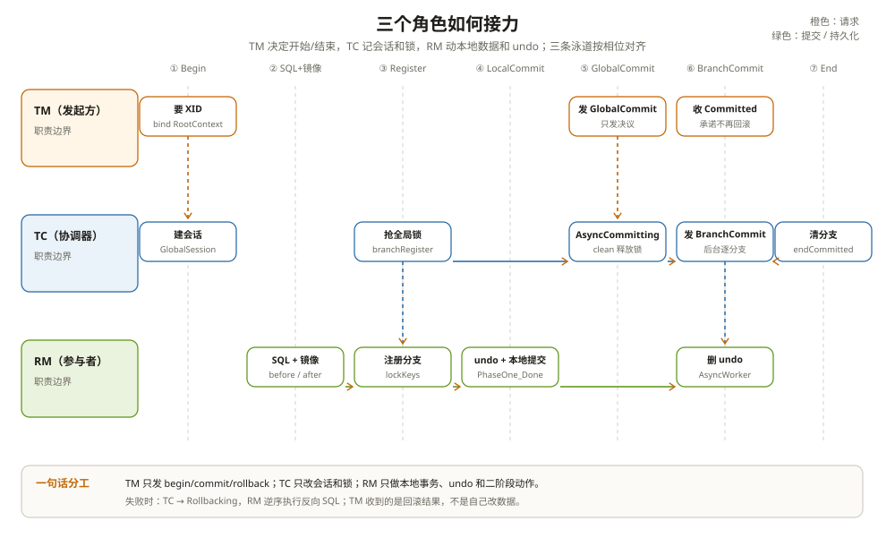

# 资源管理器 RM：一个门面，四种资源

RM 不是某一个类。

在 Seata 的代码里，`DefaultResourceManager` 是一个门面，它按 `BranchType` 持有四个真正的资源管理器：AT 的 `DataSourceManager`、TCC 的 `TCCResourceManager`、Saga 的 `SagaResourceManager`、XA 的 `ResourceManagerXA`。

一个应用可以同时接多个数据源、多个 TCC bean、一个 Saga 引擎。RM 的职责是：把这些资源登记好，在本地事务的合适时点向 TC 注册分支，并在二阶段执行提交或回滚。



---

## 一、门面模式：一个入口，四种实现

`DefaultResourceManager` 的构造过程很直接：

```text
RMClient.init()
  → EnhancedServiceLoader.loadAll(ResourceManager.class)
    → 按 rm.getBranchType() 放进 Map<BranchType, ResourceManager>
```

每个实现用 `@LoadLevel` 声明自己的分支类型，SPI 文件在各自的 `META-INF/services` 下：

- AT：`DataSourceManager`
- TCC：`TCCResourceManager`
- Saga：`SagaResourceManager`
- XA：`ResourceManagerXA`

门面自己的 `getBranchType()` 直接抛异常，因为它不是任何一种资源。所有 `branchRegister`、`branchReport`、`lockQuery`、`branchCommit`、`branchRollback` 都按 `branchType` 转发给对应的实现。

这就是为什么「一个应用的 RM」可以同时管四个库、两个 TCC bean 和一个 Saga 引擎：门面只认分支类型，资源管理器内部再按 `resourceId` 管具体资源。

---

## 二、四种资源，四种缓存

**AT：`DataSourceManager`**

`DataSourceManager.dataSourceCache` 保存 `resourceId → DataSourceProxy`。`DataSourceProxy` 在构造时把自己注册进去。一个 AT 分支的 `resourceId` 通常由 JDBC URL、数据库类型、schema 等信息算出来；同一个库的多个连接共享同一个代理。

**TCC：`TCCResourceManager`**

`tccResourceCache` 保存 `actionName → TCCResource`。`resourceId` 就是 `actionName`。同一个应用里 `actionName` 必须唯一；两个不同的 bean 用了同一个名字，启动时会直接报错。

**Saga：`SagaResourceManager`**

`sagaResourceCache` 保存状态机资源。它跟 AT/TCC 不一样：Saga 的「二阶段」不是操作某个 bean，而是调状态机引擎的 `forward` / `compensate`。

**XA：`ResourceManagerXA`**

它和 AT 共用 `AbstractDataSourceCacheResourceManager`，但 `resourceId` 对应的是 XA 数据源，二阶段动作是 `xaResource.commit/rollback`。

一个 `resourceId` 在一个分支类型下唯一；不同分支类型可以有同名资源，因为门面先按类型分流。

---

## 三、分支注册：四种模式，四个时点

这是 RM 最容易讲混的地方。四种模式注册分支的时点完全不同：

| 模式 | 注册时点 | 代码位置 |
| --- | --- | --- |
| AT | 本地 commit 前，`processGlobalTransactionCommit()` 里 | `ConnectionProxy.java:247-281` |
| TCC | 业务 try 执行之前，拦截器里 | `ActionInterceptorHandler.java:305-308` |
| Saga | 状态机 / 事务模板里，默认不逐 state 注册 | `DefaultSagaTransactionalTemplate.java:118-121` |
| XA | `setAutoCommit(false)` 时 | `ConnectionProxyXA.java:196-202` |

AT 为什么在 commit 前？因为它要收集锁键、生成 undo_log；只有到 commit 前才攒齐。

TCC 为什么在 try 前？因为 TC 必须先知道这个分支存在，confirm/cancel 才有对象。

Saga 默认不给每个状态注册分支，TC 眼里只有一个虚拟分支；二阶段由引擎自己 forward/compensate。

XA 为什么在 `setAutoCommit(false)`？因为这一下才真正开始一个 XA 分支，需要 branchId 来构造 XA-Xid。

注册请求最终都走 `AbstractResourceManager.branchRegister()`：

```text
构造 BranchRegisterRequest
  → RmNettyRemotingClient.sendSyncRequest()
    → TC BranchRegister
      → 返回 branchId
```

失败或超时包成 `RmTransactionException`。上层 AT 的 `ConnectionProxy.register()` 捕获后，会按锁冲突重试；TCC 的拦截器直接抛 `FrameworkException`。

---

## 四、branchReport / lockQuery / 二阶段

**branchReport**：RM 把分支状态上报给 TC。AT 在本地提交成功后上报 `PhaseOne_Done`；XA 在 prepare 只读时上报 `PhaseOne_RDONLY`，prepare 失败时上报 `PhaseOne_PrepareFailed`。TCC 由拦截器/资源管理器上报。

**lockQuery**：基类 `AbstractResourceManager.lockQuery()` 恒返回 false；AT 的 `DataSourceManager` 覆写成发 `GlobalLockQueryRequest` 问 TC。注意 TC 侧的 `AbstractCore.lockQuery()` 默认返回 true，而 RM 基类默认 false，两边方向相反。接非 AT 分支时不要拿 AT 的语义套。

**二阶段**：`DefaultRMHandler` 按 `request.getBranchType()` 选 handler：

- `RMHandlerAT` → `DataSourceManager.branchCommit/branchRollback` → `AsyncWorker` 或 undo 回放；
- `RMHandlerTCC` → `TCCResourceManager` → 反射调 confirm/cancel；
- `RMHandlerSaga` → `SagaResourceManager` → `engine.forward/compensate`；
- `RMHandlerXA` → `ResourceManagerXA` → `xaCommit/xaRollback`。

`AbstractRMHandler.doBranchCommit/doBranchRollback` 负责调资源管理器并把结果装进响应。

---

## 五、AT 的二阶段：入队即成功

AT 的 `DataSourceManager.branchCommit()` 调 `AsyncWorker.branchCommit()`：

```java
public BranchStatus branchCommit(String xid, long branchId, String resourceId) {
    Phase2Context context = new Phase2Context(xid, branchId, resourceId);
    addToCommitQueue(context);
    return BranchStatus.PhaseTwo_Committed;
}
```

它把任务塞进 `commitQueue` 就返回 `PhaseTwo_Committed`。真正的 undo_log 删除由另一个每秒任务批量做。

这意味着：**TC 收到「分支已提交」时，undo_log 可能还在。** 这不是 bug，提交路径上删日志是幂等清理；删不掉会重入队。

回滚路径相反：`branchRollback` 要在本地事务里执行反向 SQL，必须等结果，失败要返回可重试状态。

---

## 六、RM 的边界：它只管本地资源

RM 不参与全局状态机。它只做：

- 本地 SQL / 本地事务；
- undo_log 或 TCC 资源 / Saga 状态 / XA 分支；
- 分支注册、状态上报、锁查询；
- 二阶段的本地执行。

全局状态只有 TC 能改。RM 上报的 `PhaseOne_Done`、`PhaseTwo_Committed` 只是让 TC 知道「我这一步做完了」。

这也解释了为什么「XID 在日志里」不等于「RM 有分支」：没有经过 Seata 代理的资源、只读 SQL、解析后被放行的 DDL，都不会注册分支。具体边界见 [事务传播](../propagation/01-事务传播.md)。

---

## 七、踩坑清单

- 一个应用里有两个 TCC bean 用了同一个 `actionName`：启动时冲突。
- 以为 AT 的分支在 SQL 执行时注册：实际在本地 commit 前，锁冲突也在那时才暴露。
- 以为 XA 的 `resourceId` 是 `actionName`：XA 的 resourceId 是数据源，TCC 才是 actionName。
- 以为 Saga 每个状态都有分支：默认只有一个虚拟分支。
- 以为 `lockQuery` 在四种模式下语义一致：基类默认 false，TC 基类默认 true，AT 才覆写。
- 在 AT 的 `branchCommit` 返回后立刻查 undo_log，发现还在，就以为提交失败。

---

## 附：这一章的源码入口

一次 AT 分支注册：

```text
ConnectionProxy.commit()                              :185
  → processGlobalTransactionCommit()                  :247
    → register()                                      :267
      → DefaultResourceManager.branchRegister(AT, …)
        → DataSourceManager / AbstractResourceManager :72
          → BranchRegisterRequest → TC
    → flushUndoLogs()                                 :254
    → targetConnection.commit()                       :255
    → report(PhaseOne_Done)                           :311
```

一次 AT 二阶段提交：

```text
DefaultRMHandler.handle(BranchCommitRequest)          :57
  → RMHandlerAT → DataSourceManager.branchCommit()    :111
    → AsyncWorker.branchCommit()                      :78（入队即返回）
      → 定时 deleteUndoLog()                          :169
```

| 本文结论 | 源码证据 | 照搬之前先确认 |
| --- | --- | --- |
| 一个门面按 BranchType 分发 | `DefaultResourceManager.java:43`、`:79` | 你的自定义 RM 是否注册了 SPI |
| 四种模式的注册时点不同 | `ConnectionProxy.java:247`、`ActionInterceptorHandler.java:305`、`ConnectionProxyXA.java:196` | 你是否用 AT 的时点套 TCC/XA |
| AT 分支提交入队即成功 | `AsyncWorker.java:78` | 你的监控是否把「分支成功」当成「undo 已删」 |
| RM 不参与全局状态 | `DefaultRMHandler.java:57`、`AbstractRMHandler.java:95` | 你是否在下游期待 RM 改全局状态 |
| lockQuery 两边默认值相反 | `AbstractResourceManager.java:152`、`AbstractCore.java:190` | 你是否把 TCC/Saga/XA 当成有 AT 行锁 |

入口清单：

- `rm/src/main/java/org/apache/seata/rm/DefaultResourceManager.java`：`DefaultResourceManager`（`:43`）、SPI 注册（`:68`）、`branchRegister`（`:79`）
- `rm/src/main/java/org/apache/seata/rm/AbstractResourceManager.java`：`branchRegister()`（`:72`）、`branchReport()`（`:124`）、`lockQuery()`（`:152`）
- `rm-datasource/src/main/java/org/apache/seata/rm/datasource/DataSourceManager.java`：缓存（`:51`）、`lockQuery()`（`:53`）、`branchCommit()`（`:111`）
- `rm-datasource/src/main/java/org/apache/seata/rm/datasource/AsyncWorker.java`：定时任务（`:75`）、`branchCommit()`（`:78`）、`deleteUndoLog()`（`:169`）
- `tcc/src/main/java/org/apache/seata/rm/tcc/TCCResourceManager.java`：缓存（`:51`）、`branchCommit()`（`:109`）、`branchRollback()`（`:186`）
- `saga/seata-saga-rm/src/main/java/org/apache/seata/saga/rm/SagaResourceManager.java`：缓存（`:50`）、`branchCommit()`（`:86`）、`branchRollback()`（`:131`）
- `rm-datasource/src/main/java/org/apache/seata/rm/datasource/xa/ResourceManagerXA.java`：`finishBranch()`（`:138`）
- `rm/src/main/java/org/apache/seata/rm/DefaultRMHandler.java`：按分支类型分发（`:57`）
- `rm-datasource/src/main/java/org/apache/seata/rm/RMHandlerAT.java`（`:121`）、`RMHandlerXA.java`（`:29`）、`RMHandlerTCC.java`（`:37`）、`RMHandlerSaga.java`（`:42`）

---

## 思考题

1. 一个应用同时有 AT 数据源、TCC bean、Saga 引擎。`DefaultResourceManager` 里有几个资源管理器？它们的 `resourceId` 分别是什么？
2. AT 的分支注册为什么必须在本地 commit 前？如果放到 commit 后，会丢什么？
3. 为什么 AT 的 `branchCommit` 可以入队即返回，而 `branchRollback` 必须等结果？
4. `lockQuery` 在 RM 基类返回 false、在 TC 基类返回 true，这两个默认值分别会在什么场景下被用到？混用会发生什么？
