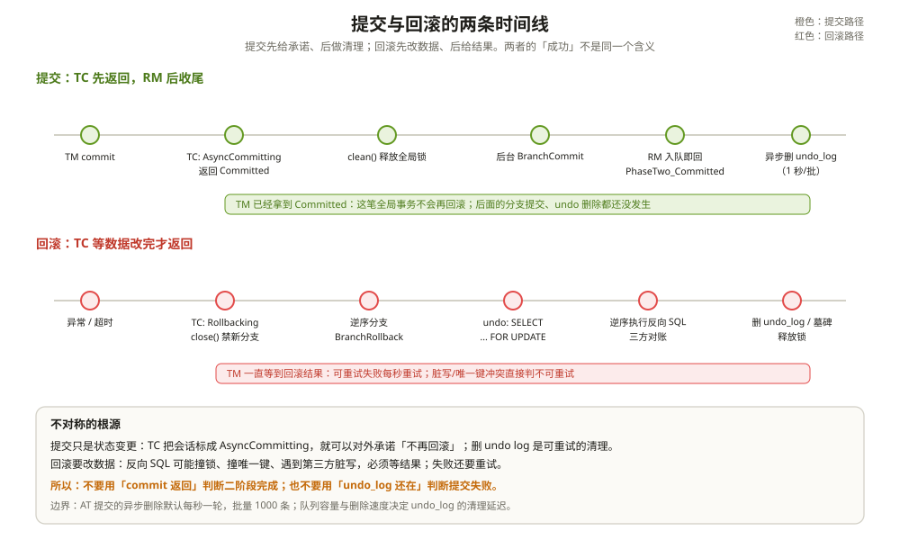

# UndoLog 与回滚机制：一条录像怎么存、怎么放

先看两个查账的场景。

场景一：TM 已经收到 `Committed`，业务日志也打了「下单成功」。五秒后去数据库看，`undo_log` 里这笔 XID 的记录还在。开发以为提交失败，手动把记录删了。

场景二：全局事务回滚了，去 `undo_log` 里查，只看到一条 `log_status=1` 的怪记录，或者什么都没有（已经被清理）。开发以为一阶段根本没写日志，怀疑 Seata 坏了。其实回滚可能比一阶段先到，Seata 在那里留了一条 `GlobalFinished` 的墓碑记录，它不能当普通 undo log 回放。

两个场景都指向同一件事：AT 的二阶段不是一个对称的流程。提交和回滚走的是两条完全不同的路，连「成功」的含义都不一样。

---

## 一、UndoLog 不是 SQL 日志

很多人以为 undo_log 里存的是「反向 SQL」。不是。

它存的是镜像：哪个库、哪张表、什么操作、改前的行、改后的行。反向 SQL 是在回滚时根据镜像现生成的。这样做的好处是：数据库方言、列类型、JSON/LOB 处理都可以在回滚时按当前表结构适配；坏处是回滚执行器要为每种数据库单独实现。

一份 undo_log 的结构：

```text
BranchUndoLog
  ├─ xid
  ├─ branchId
  └─ List<SQLUndoLog>
       ├─ sqlType（INSERT / UPDATE / DELETE）
       ├─ tableName
       ├─ beforeImage（TableRecords）
       └─ afterImage（TableRecords）
```

`TableRecords` 里是 `TableMeta` 加一组 `Row`，每个 `Field` 带列名、JDBC 类型、值、是否主键。`beforeImage` / `afterImage` 的列集合由 `getNeedColumns()` 决定：默认是「更新列 + 主键 + ON UPDATE 列」，不是整行。

序列化默认用 Jackson（`client.undo.logSerialization=jackson`），也支持 Fastjson/Fastjson2/Kryo/Fory/Protostuff 等解析器。`flushUndoLogs()` 把 `BranchUndoLog` 编码成字节数组，超过阈值时压缩，再把 `context`（序列化器、压缩器、max_allowed_packet）和 `rollback_info` 一起写进 `undo_log`。

MySQL 的 `undo_log` 表长这样：

```sql
CREATE TABLE undo_log (
  branch_id BIGINT NOT NULL,
  xid VARCHAR(128) NOT NULL,
  context VARCHAR(128) NOT NULL,
  rollback_info LONGBLOB NOT NULL,
  log_status INT NOT NULL,
  log_created DATETIME(6) NOT NULL,
  log_modified DATETIME(6) NOT NULL,
  UNIQUE KEY ux_undo_log (xid, branch_id)
);
```

`log_status` 只有两个值：`Normal(0)` 和 `GlobalFinished(1)`。前者可以回放，后者是墓碑，用来挡住一阶段后到的本地提交。

这张表写在业务库里，和业务 SQL 在同一个本地事务。不是 TC 的库，也不是 Seata 的库。

---

## 二、提交：TC 先改状态，RM 后删日志

TM 发来 `GlobalCommitRequest` 之后，`DefaultCore.commit()` 做的第一件事不是给各分支发提交请求，而是看这个全局会话能不能异步提交。

AT 分支的 `canBeCommittedAsync()` 恒为 `true`。于是 TC 把全局会话状态改成 `AsyncCommitting`，调 `clean()` 释放全局锁，直接向 TM 返回 `Committed`。`GlobalStatus` 里对这个状态的注释写得很清楚：提交还没做完，但对 TM/RM 客户端可以视为已提交。

真正的分支提交，是后台线程每秒扫一次 `AsyncCommitting` 会话，再逐个分支发 `BranchCommitRequest`。这个调度在 `DefaultCoordinator.init()` 里注册，周期由 `server.recovery.asyncCommittingRetryPeriod` 控制，默认 1000 毫秒。

RM 收到 `BranchCommitRequest` 后做了什么？`AsyncWorker.branchCommit()` 只做一件事：把 `(xid, branchId, resourceId)` 塞进 `commitQueue`，然后立刻返回 `PhaseTwo_Committed`。

```java
public BranchStatus branchCommit(String xid, long branchId, String resourceId) {
    Phase2Context context = new Phase2Context(xid, branchId, resourceId);
    addToCommitQueue(context);
    return BranchStatus.PhaseTwo_Committed;
}
```

TC 收到 `PhaseTwo_Committed`，就把这个分支从会话里删掉。全局会话的分支清空后，`endCommitted()` 把状态改成 `Committed`，整个全局事务结束。

而 undo log 还没删。它由 `AsyncWorker` 的另一个定时任务处理，默认每秒跑一次，每次最多删 1000 条，按 resourceId 分组批量删。队列容量默认 10000，满了就紧急清一次再重试入队。

所以「提交成功」的完整语义是：

- TC：这笔全局事务不会再回滚，会话状态已经落定；
- RM：分支的本地事务早就提交了，undo log 的删除只是清理工作，晚一点没关系。

删除失败怎么办？重新入队，一直删。因为提交路径上删 undo log 是幂等的，删不掉也不会改变数据。代价是 `undo_log` 表会涨，涨到影响查询性能，这是运维问题，不是一致性问题。



---

## 三、回滚：TC 倒着走，RM 逆序重放

回滚的路径完全相反。TC 不能先返回，因为回滚要改数据，改不干净就是不一致。

`DefaultCore.rollback()` 先把会话 `close()`，阻止新分支注册，然后把状态改成 `Rollbacking`，再调 `doGlobalRollback()`。分支列表用 `getReverseSortedBranches()` 取反序，从最后一个注册的分支开始回滚。

这个「逆序」不是随便定的。业务上，后做的操作依赖先做的操作：先扣库存，再写订单明细；回滚时先撤订单明细，再还库存。技术上，逆序也能降低外键和唯一约束冲突的概率。

每个分支发一条 `BranchRollbackRequest`，RM 侧进入 `AbstractUndoLogManager.undo()`。整个过程在一个本地事务里完成：

```text
1. 开本地事务（autoCommit=false）
2. SELECT * FROM undo_log WHERE branch_id=? AND xid=? FOR UPDATE
3. 如果 log_status 不是 Normal(0)，直接返回
4. 解码 rollback_info，取出 BranchUndoLog
5. 如果有多条 SQLUndoLog，Collections.reverse()
6. 逐条生成反向 SQL 并执行
7. 删除这条 undo_log
8. 提交本地事务
```

第 2 步的 `FOR UPDATE` 是为了防止两个线程同时回滚同一个分支。第 3 步的状态判断是为了幂等：TC 可能因为超时重发回滚请求，第二次进来看到状态不对，直接当成功处理。

第 5 步的逆序是另一层逆序。一个分支里可能有多条 SQL，比如先 INSERT 订单、再 UPDATE 库存。BranchUndoLog 里按执行顺序存着这些 SQL 的镜像，回滚时必须反过来：先撤库存，再删订单。只做分支级逆序、不做 SQL 级逆序，遇到有依赖的语句就会出错。

第 6 步生成的反向 SQL 分三种：

| 原 SQL | 反向 SQL | 用的是哪份镜像 |
| --- | --- | --- |
| UPDATE | `UPDATE 表 SET 非主键列 = beforeImage WHERE 主键 = ?` | beforeImage |
| DELETE | `INSERT INTO 表 (所有列) VALUES (beforeImage)` | beforeImage |
| INSERT | `DELETE FROM 表 WHERE 主键 = afterImage` | afterImage |

注意 UPDATE 的反向 SQL 只更新非主键列。主键不动，因为它用来定位行；如果业务真的改了主键，一阶段就会在镜像校验时报错，不会走到二阶段。

---

## 四、回滚比一阶段先到：一条墓碑记录

这是 AT 里设计得最巧的一处，也是最容易被忽略的。

考虑这个时序：

1. 分支的本地事务还在执行，undo log 还没写；
2. 全局事务超时，TC 开始回滚；
3. TC 给这个分支发 `BranchRollbackRequest`；
4. RM 去查 undo log，什么也没查到；
5. 分支随后执行完，准备写 undo log 并提交本地事务。

如果第 4 步什么都不做，第 5 步就会把一个已经决定回滚的分支提交掉。TC 以为回滚完成了，数据却留了下来。

Seata 的处理是：查不到 undo log 时，插入一条 `log_status = GlobalFinished(1)` 的墓碑记录，然后提交。这个记录的 `(xid, branch_id)` 和正常 undo log 相同，受唯一键约束。等第 5 步的分支来写 undo log 时，INSERT 撞唯一键，本地事务失败，分支回滚。

```text
回滚先到：
  SELECT undo_log → 无
  INSERT undo_log (log_status=GlobalFinished)
  COMMIT
一阶段后到：
  INSERT undo_log (正常) → 唯一键冲突
  本地事务回滚
```

所以「回滚了但 undo_log 表里查不到」是正常的：墓碑记录可能已经被清理，或者这次回滚根本没有走到写日志那一步。判断一个分支有没有一阶段完成，不能只看 `undo_log` 表里有没有行。

---

## 五、脏写校验：before、after、current 三方对账

回滚不是闭着眼睛执行反向 SQL。`AbstractUndoExecutor.executeOn()` 在生成反向 SQL 之前，会先做一次三方对账：

- `beforeImage`：一阶段改之前的值；
- `afterImage`：一阶段改之后的值；
- `currentRecords`：现在数据库里的值。

规则如下：

| 条件 | 判断 | 动作 |
| --- | --- | --- |
| before == after | 一阶段根本没改数据 | 跳过回滚 |
| current == after | 数据还是一阶段改完的样子 | 正常回滚 |
| current == before | 已经被别人回滚过了 | 跳过回滚 |
| 其他 | 数据被第三方改过 | 抛 `SQLUndoDirtyException`，回滚不可重试 |

最后一种就是脏写。比如 T1 把库存从 10 改成 9，T2 不走 Seata 把库存改成 8；T1 回滚时看到 current=8，既不是 before=10，也不是 after=9，就知道这行被动过。此时执行反向 SQL 会把 T2 的 8 覆盖成 10，所以 Seata 选择停下来，报 `BranchRollbackFailed_Unretriable`，让人工介入。

这个校验默认开启（`client.undo.dataValidation=true`）。关掉它，回滚会更快，但脏写会被静默覆盖。

还要注意它的边界：校验只比较 undo log 里抓到的列。前面说过，默认只抓更新列和主键。如果 T1 只更新了 `count`，T2 改了 `status`，T1 的 current 和 after 在 `count` 上仍然相等，校验通过，回滚只把 `count` 改回去，`status` 保留 T2 的值。**Seata 只对账它看见的列。**

---

## 六、失败之后：提交可以慢慢来，回滚不能

提交和回滚的失败处理也不对称。

**提交失败**：TC 把全局会话改成 `CommitRetrying`，每秒重试一次。`server.maxCommitRetryTimeout` 默认是 `-1`，也就是不设上限，一直试。分支的提交是幂等的，重试没有副作用。如果所有分支都是 AT，TC 还会走异步提交，不阻塞 TM。

**回滚失败**：分两种。

- 可重试失败：比如数据库连接断了、锁等待超时、undo log 暂时查不到。TC 每秒重试一次，`server.maxRollbackRetryTimeout` 默认也是 `-1`。
- 不可重试失败：脏写校验失败、反向 SQL 撞唯一约束、undo log 损坏。TC 把全局会话改成 `RollbackFailed`，停止重试。

回滚失败后，全局锁默认不释放。`server.rollbackFailedUnlockEnable` 默认 `false`。这意味着这行数据会一直挂在 TC 的锁表里，别的全局事务来抢锁会失败。这个行为听起来很激进，但它是在保护数据：回滚没完成之前，不能让新事务改这行，否则谁也不知道最终该是什么值。

脏写失败还会在日志里留下明确提示：`please delete the relevant undolog after manually calibrating the data`。这句话不是客套，是操作步骤。先人工把数据校准，再删掉对应的 undo log，最后让 TC 重试或手工结束会话。

---

## 七、两个容易忽略的边界

**回滚的幂等靠 undo log 状态，不靠业务方法。** TC 重发回滚时，第二次 `SELECT ... FOR UPDATE` 可能查到墓碑记录，`canUndo()` 返回 false，直接返回成功。如果查到的是正常记录，说明上一次回滚没删成功，会再执行一遍反向 SQL。反向 SQL 本身不一定幂等，比如 DELETE 的补偿是 INSERT，重复执行会撞主键。Seata 用唯一键冲突把这种情况标成不可重试，而不是假装成功。接入方要保证补偿 SQL 能承受重复执行，或者在业务层做幂等。

**异步提交队列满不会丢任务，但会拖慢提交。** `commitQueue` 是有界队列，满了之后 `addToCommitQueue()` 会先同步清一次队列，再重试入队。清队列的动作在调用线程里执行，所以 RM 处理 `BranchCommitRequest` 的线程会被拖住。队列越大，内存占用越高；队列越小，提交抖动越明显。这个参数没有万能值，要按 undo log 的删除速度和写入速度调。

---

## 八、踩坑清单

- 看到 TC 返回 `Committed` 就以为所有分支的 undo log 已删：AT 的提交是异步的。
- 在提交后手动清 `undo_log`：正常的异步删除会做，手动清只会让审计和排障少一份证据。
- 回滚日志里出现 `GlobalFinished` 就以为数据坏了：那是防止一阶段后到的墓碑记录。
- 关掉 `client.undo.dataValidation` 提升回滚速度：脏写会被静默覆盖，出了事没有告警。
- 回滚失败后手工删锁、手工清 undo log，却不校准数据：下一次重试会把错误的数据再写一遍。
- 以为 `maxCommitRetryTimeout=-1` 会永远占着连接：提交重试走的是 TC 的调度线程，不占业务连接；真正占资源的是回滚失败后不释放的全局锁。
- 把 `undo_log` 当成业务审计表：它会被异步删除，生命周期只到二阶段结束。

---

## 附：这一章的源码入口

一次全局提交，从 TC 到 RM 的调用链：

```text
DefaultCore.commit()                                  :237
  → globalSession.asyncCommit()                       :255
  → globalSession.clean()                             :262（释放全局锁）
  → 返回 Committed                                     :277
DefaultCoordinator.handleAsyncCommitting()            :524（每秒）
  → DefaultCore.doGlobalCommit(retrying=true)         :284
    → AbstractCore.branchCommit()                     :196
      → BranchCommitRequest → RM
        → AsyncWorker.branchCommit()                  :78（入队即返回）
        → 定时 deleteUndoLog()                        :169（每秒，批量 1000）
```

一次全局回滚：

```text
DefaultCore.rollback()                                :401
  → DefaultCore.doGlobalRollback()                    :424
    → getReverseSortedBranches()
      → AbstractCore.branchRollback()                 :226
        → AbstractUndoLogManager.undo()               :315
          → SELECT undo_log ... FOR UPDATE            :89
          → Collections.reverse(sqlUndoLogs)          :368
          → UndoExecutorFactory.getUndoExecutor()     :34
            → AbstractUndoExecutor.executeOn()        :114
              → dataValidationAndGoOn()               :234
              → buildUndoSQL()（三种反向 SQL）
          → deleteUndoLog / insert GlobalFinished     :399
```

| 本文结论 | 源码证据 | 照搬之前先确认 |
| --- | --- | --- |
| undo_log 存镜像，不存反向 SQL | `SQLUndoLog.java:27`、`AbstractUndoLogManager.flushUndoLogs():266`、`MySQLUndoLogManager.java:54` | 你是否以为改表结构后旧日志还能直接执行 |
| 日志写在同一本地事务，提交失败一起回滚 | `ConnectionProxy.processGlobalTransactionCommit():254` | 你的 undo_log 和业务表是否同库同事务 |
| AT 提交对 TM 先返回，分支提交和删 undo 异步 | `DefaultCore.commit():255`、`AsyncWorker.branchCommit():78` | 你的监控是否把 `Committed` 当成「所有分支二阶段完成」 |
| 回滚按分支逆序、分支内 SQL 也逆序 | `GlobalSession.getReverseSortedBranches():423`、`AbstractUndoLogManager.undo():368` | 你的补偿是否依赖执行顺序；逆序是 Seata 的默认，不是业务语义 |
| 回滚前做三方对账，脏写不可重试 | `AbstractUndoExecutor.dataValidationAndGoOn():234` | 你是否关了 `client.undo.dataValidation`；关了就没有这层保护 |
| 一阶段没写日志时，回滚会插墓碑记录 | `AbstractUndoLogManager.undo():409` | 你的排障脚本是否把 `GlobalFinished` 当成脏数据删掉 |
| 回滚失败默认不释放全局锁 | `DefaultValues.DEFAULT_ROLLBACK_FAILED_UNLOCK_ENABLE:543` | 你的告警是否能区分「业务锁等待」和「回滚失败留下的锁」 |

入口清单：

- `server/src/main/java/org/apache/seata/server/coordinator/DefaultCore.java`：`commit()`（`:237`）、`doGlobalCommit()`（`:284`）、`rollback()`（`:401`）、`doGlobalRollback()`（`:424`）
- `server/src/main/java/org/apache/seata/server/coordinator/DefaultCoordinator.java`：`handleRetryRollbacking()`（`:451`）、`handleRetryCommitting()`（`:487`）、`handleAsyncCommitting()`（`:524`）
- `server/src/main/java/org/apache/seata/server/coordinator/AbstractCore.java`：`branchCommit()`（`:196`）、`branchRollback()`（`:226`）
- `rm-datasource/src/main/java/org/apache/seata/rm/datasource/AsyncWorker.java`：定时任务（`:75`）、`branchCommit()`（`:78`）、`doBranchCommit()`（`:110`）、`deleteUndoLog()`（`:169`）
- `rm-datasource/src/main/java/org/apache/seata/rm/datasource/undo/AbstractUndoLogManager.java`：`flushUndoLogs()`（`:266`）、`SELECT ... FOR UPDATE`（`:89`）、`undo()`（`:315`）、逆序（`:368`）、墓碑记录（`:409`）、脏写映射（`:432`）
- `rm-datasource/src/main/java/org/apache/seata/rm/datasource/undo/SQLUndoLog.java`：镜像结构（`:27`）
- `rm-datasource/src/main/java/org/apache/seata/rm/datasource/undo/UndoLogParser.java`：序列化接口
- `rm-datasource/src/main/java/org/apache/seata/rm/datasource/undo/mysql/MySQLUndoLogManager.java`：INSERT 列（`:54`）
- `script/client/at/db/mysql.sql`：`undo_log` DDL（`:19`）
- `rm-datasource/src/main/java/org/apache/seata/rm/datasource/undo/AbstractUndoExecutor.java`：`executeOn()`（`:114`）、`dataValidationAndGoOn()`（`:234`）
- `rm-datasource/src/main/java/org/apache/seata/rm/datasource/undo/mysql/MySQLUndoUpdateExecutor.java`：`buildUndoSQL()`（`:50`）
- `rm-datasource/src/main/java/org/apache/seata/rm/datasource/undo/mysql/MySQLUndoDeleteExecutor.java`：`buildUndoSQL()`（`:62`）
- `rm-datasource/src/main/java/org/apache/seata/rm/datasource/undo/mysql/MySQLUndoInsertExecutor.java`：`buildUndoSQL()`（`:52`）
- `common/src/main/java/org/apache/seata/common/DefaultValues.java`：`DEFAULT_MAX_COMMIT_RETRY_TIMEOUT`（`:533`）、`DEFAULT_MAX_ROLLBACK_RETRY_TIMEOUT`（`:538`）、`DEFAULT_ROLLBACK_FAILED_UNLOCK_ENABLE`（`:543`）

---

## 思考题

1. 一个全局事务提交成功，`undo_log` 里还有它的记录。可能是哪几种情况？分别该怎么处理？
2. 回滚时查到 `log_status=GlobalFinished`，说明发生了什么？为什么不能把它当普通 undo log 回放？
3. T1 更新了 `count`，T2 不走 Seata 更新了同一行的 `status`。T1 回滚时会发生什么？如果 T2 改的也是 `count`，又会发生什么？
4. 为什么回滚失败后默认不释放全局锁？如果业务要求「先让新事务跑起来」，应该改哪个配置，代价是什么？
