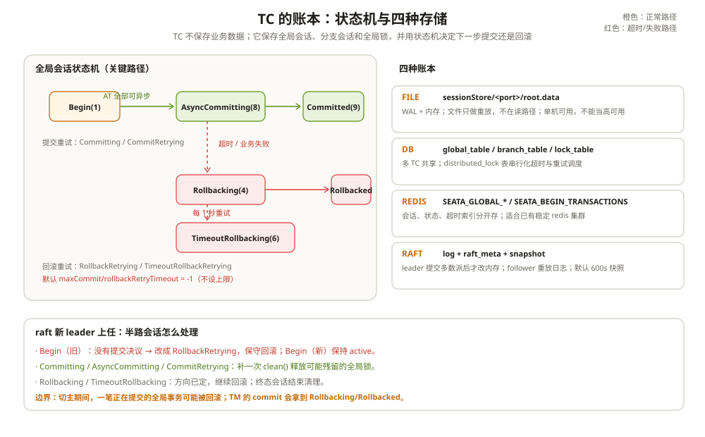

# Raft 集群与高可用：一台 TC 倒下之后

有一次 Seata 集群切主，切完之后监控上出现一批回滚。

奇怪的是，这些全局事务里有几笔在业务日志里已经打到了「准备提交」，TM 还没来得及发 `GlobalCommitRequest`。运维问：数据都改完了，为什么回滚？

答案在 TC 的会话账本里。新的 leader 上任时，会重新加载会话。对于那些还停在 `Begin`、又没有留下任何提交决议的全局事务，它没有足够的证据判断「这笔事务到底该提交还是回滚」。既然一阶段已经提交到本地库、undo log 也还在，回滚是唯一能保证一致性的选择。于是它把这些旧会话改成 `RollbackRetrying`，一轮一轮地回滚。

这不是 bug，是 TC 在信息不全时做的保守决策。要理解它，得先知道 TC 到底记了什么账、这些账存在哪里、一台 TC 倒下之后这些账怎么被重新读出来。

会话/锁和 UndoLog 的细节分别放在 [会话与锁管理](./01-会话与锁.md) 和 [UndoLog 与回滚机制](./02-UndoLog与回滚.md)；这一篇只讲存储、选主和故障恢复。

---

## 一、TC 记的是三本账

TC 不存业务数据。它存的是三类东西：

| 账本 | 里面有什么 | 干什么用 |
| --- | --- | --- |
| 全局会话 | XID、应用 ID、事务组、事务名、超时、状态、开始时间 | 回答「这笔全局事务走到哪了」 |
| 分支会话 | branchId、resourceId、branchType、状态、clientId、applicationData | 回答「这笔全局事务有哪些参与者，各自到哪一步」 |
| 全局锁 | 资源 ID、表名、主键、持有者 XID/branchId、锁状态 | 回答「哪些行被哪个分支占着」 |

这三本账合起来，就是 TC 恢复时需要的全部信息。业务数据在各自的数据库里，undo log 在业务库里，TC 不需要也不应该去读它们。

注意，全局锁和分支会话是分开存的。会话是「谁参与了」，锁是「谁占着哪一行」。一个分支可能没有锁（TCC、Saga、只读分支），一把锁也可能在分支结束前就被释放（AT 异步提交时 `clean()` 会提前放全局锁）。

---

## 二、状态机：21 个全局状态，16 个分支状态

`GlobalStatus` 有 21 个枚举值。第一次看会觉得多，其实可以分成四组：

**一阶段**：

- `Begin(1)`：可以接受新分支注册；
- `UnKnown(0)`：还没有 begin，或者状态不明。

**二阶段进行中**：

- `Committing(2)`、`CommitRetrying(3)`：同步提交、提交重试；
- `AsyncCommitting(8)`：AT 专用的异步提交，对外可视为已提交；
- `Rollbacking(4)`、`RollbackRetrying(5)`：回滚、回滚重试；
- `TimeoutRollbacking(6)`、`TimeoutRollbackRetrying(7)`：超时触发的回滚、重试。

**终态**：

- `Committed(9)`、`CommitFailed(10)`；
- `Rollbacked(11)`、`RollbackFailed(12)`；
- `TimeoutRollbacked(13)`、`TimeoutRollbackFailed(14)`；
- `Finished(15)`：会话已经不在 TC 的管理范围里。

**收尾与人工干预**：

- `CommitRetryTimeout(16)`、`RollbackRetryTimeout(17)`：重试超时后停下的状态；
- `Deleting(18)`、`StopCommitOrCommitRetry(19)`、`StopRollbackOrRollbackRetry(20)`。

分支状态少一些，但有 16 个：

- `Registered(1)`：分支注册完成，一阶段还没上报；
- `PhaseOne_Done(2)`、`PhaseOne_Failed(3)`、`PhaseOne_Timeout(4)`；
- `PhaseTwo_Committed(5)`、`PhaseTwo_CommitFailed_Retryable(6)`、`PhaseTwo_CommitFailed_Unretryable(7)`；
- `PhaseTwo_Rollbacked(8)`、`PhaseTwo_RollbackFailed_Retryable(9)`、`PhaseTwo_RollbackFailed_Unretryable(10)`；
- `PhaseOne_RDONLY(13)`：XA 只读分支；
- `PhaseOne_PrepareFailed(15)`：XA prepare 失败；
- 还有 `Unknown`、`STOP_RETRY` 和两个 XAER_NOTA 状态。

状态多，是因为每一种「失败但还能再试」和「失败且不能再试」都要有独立的状态。如果只用一个 `Failed`，TC 就分不清该重试还是该报警。

正常 AT 提交的状态迁移是这样的：

```text
Begin
  → 所有分支已上报 PhaseOne_Done
  → close()                          // 不再接受新分支
  → AsyncCommitting                  // AT 全部可异步
  → clean()                          // 释放全局锁
  → 返回 Committed
  → 后台逐分支 BranchCommit
  → 分支 PhaseTwo_Committed
  → 删除分支
  → endCommitted() → Committed
```

正常 AT 回滚：

```text
Begin
  → close()
  → Rollbacking
  → 逆序逐分支 BranchRollback
  → 分支 PhaseTwo_Rollbacked
  → 删除分支，释放锁
  → endRollbacked() → Rollbacked
```



注意 `AsyncCommitting` 和 `Committed` 的关系：前者是 TC 内部状态，后者是对外承诺。TC 返回 `Committed` 时，会话可能还停在 `AsyncCommitting`。下一次扫描如果发现分支已经清空，才把它改成 `Committed` 或直接结束。

---

## 三、超时：TC 和 TM 各算各的

默认全局事务超时是 60 秒。这个值来自 `@GlobalTransactional.timeoutMills` 的默认值，也来自 `client.tm.defaultGlobalTransactionTimeout`。TM begin 时把它塞进 `GlobalBeginRequest`，TC 存进 `GlobalSession.timeout`。

TC 侧每秒扫一次 `Begin` 状态的会话：

```text
timeoutCheck()
  → 找出所有 Begin 会话
  → 对每个会话加锁
  → 如果状态还是 Begin 且 now - beginTime > timeout
      → close()
      → 改成 TimeoutRollbacking
      → 交给 handleRetryRollbacking 去回滚
```

扫描周期由 `server.recovery.timeoutRetryPeriod` 控制，默认 1000 毫秒。

TM 侧也有自己的超时判断。`TransactionalTemplate.commitTransaction()` 在调用 `tx.commit()` 之前，会先看 `isTimeout(tx.getCreateTime(), txInfo)`：

- 如果本地已经超时，TM 不再发 `GlobalCommitRequest`，直接走回滚；
- 如果本地没超时，但 TC 已经因为超时把状态改成了 `TimeoutRollbacking`，TC 会把 `TimeoutRollbacking` 返回给 TM，TM 收到后抛 `TransactionExceptionCode.TransactionTimeout`。

两个超时用的是同一个 `timeout` 值，但触发点不一样：TM 在提交前判断，TC 在每秒扫描时判断。由于网络和调度延迟，两边可能差几百毫秒。**不要依赖「刚好 60 秒」这个边界**，业务耗时接近超时时间时，回滚可能先于提交到达。

超时扫描只扫 `Begin`。一旦进入 `Rollbacking` 或 `Committing`，就交给对应的重试任务，不再参与超时判断。这是为了避免一个已经在回滚的事务被重复标记超时。

---

## 四、重试：默认不设上限

TC 有三条重试线，都是每秒一轮：

| 任务 | 扫描的状态 | 周期配置 | 默认最大时长 |
| --- | --- | --- | --- |
| `handleAsyncCommitting` | `AsyncCommitting` | `server.recovery.asyncCommittingRetryPeriod` | 无（直到分支清空） |
| `handleRetryCommitting` | `CommitRetrying` | `server.recovery.committingRetryPeriod` | `server.maxCommitRetryTimeout`，默认 -1 |
| `handleRetryRollbacking` | `TimeoutRollbacking`、`TimeoutRollbackRetrying`、`RollbackRetrying` | `server.recovery.rollbackingRetryPeriod` | `server.maxRollbackRetryTimeout`，默认 -1 |

`-1` 的意思是无限重试。`isRetryTimeout()` 只在 `timeout >= ALWAYS_RETRY_BOUNDARY` 时才判断 `now - beginTime > timeout`，`-1` 直接短路成 false。

这个默认值对一致性友好，对运维不友好。一个回滚失败的分支如果一直重试，全局锁就一直不释放，后面的业务会持续报锁冲突。你会看到「业务没报错，但某个订单一直提交不了」这种很隐蔽的故障。

有人会把 `retryDeadThreshold`（默认 70 秒）当成「最大重试时间」。不是。它是 `GlobalSession.timeToDeadSession()` 里的一个阈值，用来判断会话是不是已经「死」到可以被清理，不参与提交/回滚重试的终止判断。真正控制停止的是 `maxCommitRetryTimeout` 和 `maxRollbackRetryTimeout`。

重试的粒度是分支，不是全局事务。`doGlobalCommit()` 和 `doGlobalRollback()` 会遍历分支，成功的分支从会话里删掉，失败的分支留在列表里，下一轮只重试剩下的。所以一个全局事务重试了十轮，不代表十个分支都失败了；可能每轮只卡在同一个分支上。

---

## 五、四种存储：同一本账，四种活法

TC 的会话存储由 `store.session.mode` 决定，默认 `file`。四种模式的差别不是「快慢」，而是「账本放在哪、谁能看到、挂了怎么恢复」。

### 5.1 file：WAL + 内存

目录默认是 `sessionStore/<port>/root.data`，历史文件是 `root.data.1`。每次会话变更先写 4 字节长度、再写序列化后的 `GlobalSession/BranchSession`、最后写 1 字节操作码，然后 `force` 到磁盘。

文件只是 WAL。会话真正读的时候从内存的 `sessionMap` 拿，`FileTransactionStoreManager.readSession()` 直接抛 `StoreException("unsupport for read from file")`。启动时 `FileSessionManager.restoreSessions()` 把历史文件和当前文件从头重放一遍，把会话恢复到内存。

这带来两个直接后果：

- file 模式只能单机。两个 TC 各自有一份 `sessionMap`，互相看不见；`DistributedLockerFactory` 对 file 模式直接返回一个永远成功的默认锁，file 模式下的「分布式锁」等于没有。
- 进程挂了，未落盘的那一段会话会丢。虽然每次写都 force，但内存里的状态和文件之间仍有时间窗。

file 适合本地开发和单机部署，不适合当高可用方案。

### 5.2 db：三张表 + 一把分布式锁

db 模式把三本账放进三张表：

- `global_table`：一行一个全局会话，主键 `xid`；
- `branch_table`：一行一个分支，主键 `branch_id`，`xid` 上有索引；
- `lock_table`：一行一把行锁，主键 `row_key`，`status` 0 表示 locked、1 表示 rollbacking。

多台 TC 共享同一个库，会话天然共享。问题是调度任务也会重复：每台 TC 都在跑超时扫描、提交重试、回滚重试。Seata 用 `distributed_lock` 表把它们串起来，`AsyncCommitting`、`RetryCommitting`、`RetryRollbacking`、`TxTimeoutCheck` 各有一行锁。抢到锁的 TC 才执行这一轮任务，抢不到就跳过。

`DataBaseDistributedLocker` 用 `SELECT ... FOR UPDATE` 加过期时间实现。配置里没指定 `distributed_lock` 表名时，它会进入降级模式（`demotion=true`），直接返回成功。这是 1.5.0 的兼容行为，不是数据库宕机自动降级。多台 TC 同时降级，重复调度就回来了。

### 5.3 redis：会话、状态、时间线分开存

redis 模式把会话拆成几类 key：

```text
SEATA_GLOBAL_<transactionId>       // 全局会话 hash
SEATA_BRANCH_<branchId>            // 分支会话 hash
SEATA_BRANCHES_<xid>               // 这个 XID 下的分支 key 列表
SEATA_STATUS_<statusCode>          // 某个状态下的 XID 列表
SEATA_BEGIN_TRANSACTIONS           // zset，score = beginTime + timeout
```

`SEATA_BEGIN_TRANSACTIONS` 是超时扫描的索引。TC 不需要遍历所有全局会话，只要按 score 查出已经到期的 XID。这也是 redis 模式比 db 模式更适合大事务量的原因之一。

行锁用 `SEATA_GLOBAL_LOCK*` 和 `SEATA_ROW_LOCK_*` 两组 key，和会话分开。redis 模式适合已经有稳定 redis 集群、又不想让 TC 直连业务库的场景；代价是多了一套需要高可用的 redis。

### 5.4 raft：账本变成复制日志

raft 模式下，`RaftSessionManager` 继承 `FileSessionManager`，但不落本地文件，会话在内存里。每次 `begin`、加分支、改状态，都会封装成一条 JRaft Task：

```text
leader:
  RaftTaskUtil.createTask(...)
    → JRaft apply(task)
    → 多数派 commit
    → done 回调里改 leader 的内存 sessionMap
    → futureGet() 等结果返回
follower:
  RaftStateMachine.onApply()
    → 解码 RaftSyncMessage
    → onExecuteRaft()
    → 改 follower 的内存 sessionMap
```

leader 不是先改内存再复制，而是等 JRaft commit 回调才改。这样 leader 挂了，已经返回给客户端的提交不会丢；新 leader 的日志里一定有这条记录。

raft 的会话目录在 `sessionStore/raft/<raftPort>/<group>/{log,raft_meta,snapshot}`，快照默认每 600 秒做一次。快照保存的是当前会话、锁、vgroup 映射、集群元数据；新 follower 加载快照后再重放日志。

raft 模式下只有 leader 处理事务。`RaftCoordinator.exceptionHandleTemplate()` 会检查当前节点是不是 leader，不是就返回 `NotRaftLeader`，HTTP 写请求也会被 `RaftRequestFilter` 拦住。客户端通过注册中心拿到的地址列表里，raft 模式只缓存 leader；leader 换了，客户端要重新 lookup。

---

## 六、一台 TC 倒下之后

不同存储模式的恢复路径不一样。

**file 模式**：进程挂了，内存里的会话没了。文件能恢复已落盘的部分，但只有这一台机器能读。没有「另一台接管」这回事。

**db / redis 模式**：会话在共享存储里，另一台 TC 直接读。启动时 `reload()` 会把错误终态的会话清理掉，活跃会话继续由调度任务推进。db 模式的分布式锁保证同一轮任务只有一台 TC 跑。

**raft 模式**：leader 挂了，JRaft 重新选主。新 leader 上任后做两件事：

1. 加载快照、重放日志，把会话恢复到内存；
2. 调 `SessionHolder.reload(..., SessionMode.RAFT, false)` 处理「半路会话」。

第二步是重点。`reload()` 对不同状态的处理不一样：

| 会话状态 | raft 新 leader 的动作 | 为什么 |
| --- | --- | --- |
| `Begin`，且 beginTime 早于当前时间 | 改成 `RollbackRetrying` | 没有提交决议，保守回滚 |
| `Begin`，且 beginTime 不早于当前时间 | 保持 active | 这是新 leader 上任后新开的会话，不能误伤 |
| `Committing` / `AsyncCommitting` / `CommitRetrying` | `clean()` 释放全局锁 | 重新选主可能留下没释放的锁；提交本身是幂等的，可以继续 |
| `Rollbacking` / `RollbackRetrying` / `TimeoutRollbacking` | 继续回滚 | 方向已经确定 |
| `Committed` / `Rollbacked` / `TimeoutRollbacked` | 结束并清理 | 已经是终态 |
| `Finished` / `Unknown` / `CommitFailed` / `RollbackFailed` / `TimeoutRollbackFailed` | 从账本里移除 | 错误终态不再推进 |

「`Begin` 保守回滚」是理解 raft 模式 Seata 的关键。TC 没有记录「TM 是否已经决定提交」，只在会话里看到一个还没结束的一阶段。此时如果继续等，可能永远等不到 TM；如果当成提交，又可能把一笔本该回滚的事务提交掉。回滚至少能保证：一阶段写下的 undo log 还在，数据可以回到一致状态。

代价是：**切主期间，一笔正在提交的全局事务可能被回滚**。TM 之后发来的 `GlobalCommitRequest` 会拿到 `Rollbacking` 或 `Rollbacked`，业务侧看到的是提交失败。这不是数据错误，是可用性换一致性的取舍。

---

## 七、运维视角：先看哪几个数

TC 的故障，表面上看是「事务卡住」，实际原因通常落在四个地方：

1. **会话积压**：`AsyncCommitting`、`CommitRetrying`、`RollbackRetrying` 的数量在涨。说明分支提交或回滚在失败，先看 RM 的日志和数据库连接。
2. **超时扫描延迟**：`timeoutCheck` 每秒扫一次，如果单次扫描耗时超过一秒，超时会堆积。看 TC 的 CPU 和会话数量。
3. **全局锁冲突**：`lock_table` 或 `FileLocker` 里某把锁长期不释放。先看持有者的分支状态，再看它是不是回滚失败。
4. **存储层故障**：db 的 `distributed_lock` 抢不到、redis 的 `SEATA_BEGIN_TRANSACTIONS` 不更新、raft 没有 leader。这三种情况的表现都是「TC 还在，但事务不推进」。

还有一个小细节：TC 的 `undoLogDelete` 任务会定期给 RM 发 `UndoLogDeleteRequest`，让 RM 删除超过保存天数的 undo log。这是清理一阶段完成但二阶段没走到的孤儿日志，不是正常提交路径的一部分。看到 RM 收到这个请求，不要误以为 TC 在回滚。

---

## 八、踩坑清单

- 用 file 模式起两台 TC 做高可用：会话不共享，分布式锁是空实现，两台各自扫描、各自回滚。
- db 模式多台 TC 共享库，却没初始化 `distributed_lock` 的行：调度锁抢不到，任务不跑。
- raft 模式把请求发到 follower，看到 `NotRaftLeader` 以为集群坏了：这是正常的拒写，客户端应该重新 lookup leader。
- 把 `server.maxCommitRetryTimeout` / `maxRollbackRetryTimeout` 的 `-1` 当成「永远不会卡」：它会一直重试，也会一直占着全局锁。
- 把 `retryDeadThreshold=70s` 当成最大重试时间：它只影响会话死亡的判定，不控制重试停止。
- 切主后看到一批 `Begin` 被回滚，以为数据丢了：先看这些会话有没有提交决议，再看 undo log 是否完整。
- 以为 TC 重启会「恢复所有事务」：file 模式恢复不了跨机，db/redis 依赖共享存储，raft 依赖日志复制，三种恢复的边界完全不同。

---

## 附：这一章的源码入口

TC 启动时选择会话存储：

```text
SessionHolder.init()                                  :100
  → StoreConfig.getSessionMode()                      :111
  → EnhancedServiceLoader.load(SessionManager, mode)  // file/db/redis/raft
  → reload(sessionMode)                               :166
```

超时与重试调度：

```text
DefaultCoordinator.timeoutCheck()                     :406（每秒）
  → 状态改为 TimeoutRollbacking                       :434
DefaultCoordinator.handleAsyncCommitting()            :524（每秒）
DefaultCoordinator.handleRetryCommitting()            :487（每秒）
DefaultCoordinator.handleRetryRollbacking()           :451（每秒）
  → isRetryTimeout()                                  :573
```

raft 的提交与恢复：

```text
RaftSessionManager.onBegin()                          :69
  → RaftTaskUtil.createTask()                         :38
    → JRaft apply → 多数派 commit → 回调改内存
RaftStateMachine.onApply()                            :171（follower 重放）
RaftStateMachine.onLeaderStart()                      :234
  → SessionHolder.reload(..., RAFT, false)            :249
    → 旧 Begin 改成 RollbackRetrying                  :251
    → Committing/AsyncCommitting 补解锁               :222
```

| 本文结论 | 源码证据 | 照搬之前先确认 |
| --- | --- | --- |
| 默认全局超时 60 秒，TC 每秒扫描 | `DefaultValues.DEFAULT_GLOBAL_TRANSACTION_TIMEOUT:297`、`DefaultCoordinator.timeoutCheck():406` | 你的业务耗时是否贴近 60 秒；TM 和 TC 两边都可能先判超时 |
| 提交/回滚重试默认无限 | `DefaultValues.DEFAULT_MAX_COMMIT_RETRY_TIMEOUT:533`、`DEFAULT_MAX_ROLLBACK_RETRY_TIMEOUT:538` | 你的监控是否能发现长期重试；无限重试会长期占锁 |
| file 模式只有内存会话，文件是 WAL | `FileTransactionStoreManager.readSession():317`、`FileSessionManager.restoreSessions()` | 你是否把 file 模式当高可用；它不是 |
| raft 新 leader 会把旧 `Begin` 转回滚 | `SessionHolder.reload():246`、`changeGlobalStatus(RollbackRetrying):251` | 切主时业务能否接受「提交变回滚」 |
| raft 只有 leader 处理事务 | `RaftCoordinator.exceptionHandleTemplate():46` | 客户端是否能从 `NotRaftLeader` 里恢复并重新 lookup |
| db 多 TC 靠 `distributed_lock` 串行化调度 | `script/server/db/mysql.sql:78`、`DataBaseDistributedLocker.acquireLock():116` | 你的库是否初始化了锁表的四行记录 |

入口清单：

- `server/src/main/java/org/apache/seata/server/session/SessionHolder.java`：`init()`（`:100`）、`reload()`（`:166`）、raft 旧 Begin 转回滚（`:246`）
- `server/src/main/java/org/apache/seata/server/session/GlobalSession.java`：`isTimeout()`（`:210`）、`getReverseSortedBranches()`（`:423`）
- `server/src/main/java/org/apache/seata/server/store/StoreConfig.java`：`getSessionMode()`（`:111`）、`getLockMode()`（`:130`）
- `server/src/main/java/org/apache/seata/server/coordinator/DefaultCoordinator.java`：`timeoutCheck()`（`:406`）、`handleRetryRollbacking()`（`:451`）、`handleRetryCommitting()`（`:487`）、`handleAsyncCommitting()`（`:524`）、`isRetryTimeout()`（`:573`）
- `server/src/main/java/org/apache/seata/server/storage/file/store/FileTransactionStoreManager.java`：`writeSession()`（`:179`）、`readSession()`（`:317`）
- `server/src/main/java/org/apache/seata/server/storage/file/session/FileSessionManager.java`：`restoreSessions()`
- `server/src/main/java/org/apache/seata/server/storage/raft/session/RaftSessionManager.java`：`onBegin()`（`:69`）
- `server/src/main/java/org/apache/seata/server/cluster/raft/RaftStateMachine.java`：`isLeader()`（`:140`）、`onApply()`（`:171`）、`onLeaderStart()`（`:234`）
- `server/src/main/java/org/apache/seata/server/cluster/raft/RaftServerManager.java`：快照周期（`:224`）
- `server/src/main/java/org/apache/seata/server/coordinator/RaftCoordinator.java`：leader 检查（`:46`）
- `server/src/main/java/org/apache/seata/server/storage/redis/store/RedisTransactionStoreManager.java`：key 前缀（`:81`–`:99`）
- `script/server/db/mysql.sql`：`global_table`（`:20`）、`branch_table`（`:40`）、`lock_table`（`:59`）、`distributed_lock`（`:78`）

---

## 思考题

1. 一笔全局事务在 TC 重启前停在 `Begin`，重启后被改成 `RollbackRetrying`。此时 TM 发来 commit，会发生什么？业务应该怎么处理这个结果？
2. 为什么 raft 模式要在新 leader 上任时对 `Committing` 会话补一次 `clean()`？提交还没完成，提前放锁会不会让别的分支写进来？
3. file 模式和 db 模式都支持「重启恢复」，但恢复出来的东西有什么本质区别？
4. 你的 TC 用的是哪种存储？如果现在挂掉一台，哪些事务会自动回滚，哪些会继续提交，哪些会永远卡住？
