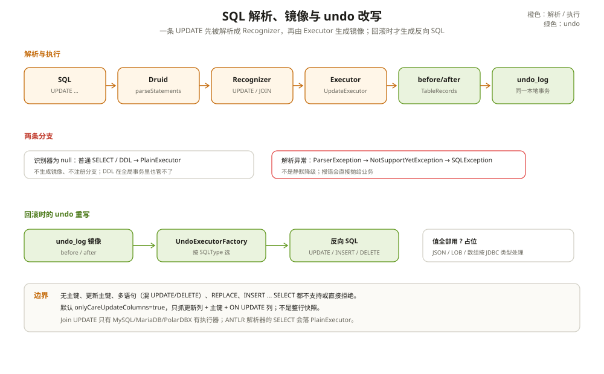

# SQL 解析与重写

AT 的自动补偿，从一条 SQL 被看懂开始。

Seata 要知道这条 SQL 改了哪张表、哪一行、哪些列，才能生成前后镜像、锁键和 undo_log。它不靠正则，也不靠字符串拼接，而是把 SQL 交给解析器，生成一棵语法树，再按 SQL 类型选执行器。

这一篇讲这条解析链，以及它到底能看懂什么、看不懂什么。

---

## 一、解析器：默认 Druid，也可以换 ANTLR

`SQLVisitorFactory` 在静态块里按 `client.rm.sqlParserType` 选 `SQLRecognizerFactory`，默认 `druid`：

```text
client.rm.sqlParserType = druid
  → DruidSQLRecognizerFactoryImpl
    → SQLUtils.parseStatements(sql, dbType)
```

Druid 版本是 1.2.28，Seata 通过隔离 ClassLoader 反射加载实现，避免和业务应用自带的 Druid 版本冲突。

除了 Druid，还有 `seata-sqlparser-antlr`（ANTLR4 + MySQL 语法）。它只支持 MySQL，按 DML 子节点分派识别器。选 ANTLR 要确认版本和方言覆盖，别在生产环境随手切换。

POLARDBX 会先适配成 MySQL 再解析。Oracle 的多表插入有单独处理。

---

## 二、识别：一条 SQL 被归到哪一类

解析之后，`SQLVisitorFactory.get()` 返回一组 `SQLRecognizer`。识别器决定了 SQL 类型：

| SQL | 识别结果 | 说明 |
| --- | --- | --- |
| INSERT | `INSERT` 或 `INSERT_ON_DUPLICATE_UPDATE` | 带 `ON DUPLICATE KEY UPDATE` 时是后者 |
| UPDATE | `UPDATE` 或 `UPDATE_JOIN` | 更新表是 Join 时是后者 |
| DELETE | `DELETE` | |
| SELECT ... FOR UPDATE | `SELECT_FOR_UPDATE` | 普通 SELECT 返回 null |
| REPLACE | 抛异常 | 不支持 |

`SQLRecognizer` 家族分得很细：`SQLInsertRecognizer`、`SQLUpdateRecognizer`、`SQLDeleteRecognizer`、`SQLSelectRecognizer`，都继承根接口。Druid 侧的 `BaseMySQLRecognizer` 再按方言实现。

普通 SELECT 返回 null，`ExecuteTemplate` 会走 `PlainExecutor`，不生成镜像、不注册分支。这不是错误——只读 SQL 本来就不需要 undo。

---

## 三、执行器：解析成功之后怎么选

`ExecuteTemplate.execute()` 先分流：

```java
if (!RootContext.requireGlobalLock() && BranchType.AT != RootContext.getBranchType()) {
    return statementCallback.execute(...);   // 非 AT，直接执行
}
```

然后按识别器数量分：

- 0 个：`PlainExecutor`，原样执行；
- 1 个：按 `SQLType` 选 `InsertExecutor` / `UpdateExecutor` / `DeleteExecutor` / `SelectForUpdateExecutor`，以及 `INSERT_ON_DUPLICATE_UPDATE` / `UPDATE_JOIN` 的方言实现；
- 多个：`MultiExecutor`。

解析失败不是静默降级。Druid 的 `ParserException` 会被转成 `NotSupportYetException`，最终包成 `SQLException` 抛出。这一点和很多人的印象相反：真正静默放行的是「识别器为 null」的普通 SELECT、DDL，不是解析报错的 SQL。

DDL 在全局事务里会被原样执行，不产生 undo、不注册分支。**在全局事务里做 DDL，Seata 管不了。**

DDL 在全局事务里会被原样执行，不产生 undo、不注册分支。**在全局事务里做 DDL，Seata 管不了。**



---

## 四、镜像：哪些列会被抓

执行器在业务 SQL 前后生成镜像：

- UPDATE：beforeImage 是 `SELECT <需关注列> FROM t WHERE ... FOR UPDATE`；afterImage 按主键回查；
- DELETE：beforeImage 取全列并 `FOR UPDATE`；afterImage 为空；
- INSERT：beforeImage 为空；afterImage 按主键回查。

「需关注列」由 `getNeedColumns()` 决定。默认 `client.undo.onlyCareUpdateColumns=true`，只抓：

- SET 子句里的列；
- 主键列；
- 表定义里 `ON UPDATE` 的列。

只有把 `onlyCareUpdateColumns` 设成 false，才抓全列。

元数据来自 `TableMetaCache`。它用 Caffeine 缓存，最多 10 万条、写入后 900 秒过期、softValues；每个 DataSource 还有一个 60 秒的检查线程做刷新。缓存拿不到表元数据会抛异常。

`TableRecords` 是镜像容器：`TableMeta` + `List<Row>`，每个 `Field` 带列名、JDBC 类型、值、是否主键。undo_log 序列化的就是它，不是 SQL 字符串。

---

## 五、undo 重写：回滚时才生成 SQL

一阶段不生成反向 SQL，只存镜像。二阶段回滚时，`UndoExecutorFactory` 按 `SQLType` 选执行器：

- UPDATE → `MySQLUndoUpdateExecutor`：`UPDATE t SET 非主键列=? WHERE pk=?`；
- DELETE → `MySQLUndoDeleteExecutor`：`INSERT INTO t (所有列) VALUES (...)`；
- INSERT → `MySQLUndoInsertExecutor`：`DELETE FROM t WHERE pk=?`。

值全部用 `?` 占位，逐行 `executeUpdate`。JSON、LOB、数组等类型在 `undoPrepare()` 里按 JDBC 类型处理；主键参数放在最后。

为什么不在阶段一生成 SQL？因为回滚时的表结构、方言、列类型可能和阶段一不同；存镜像更稳，生成 SQL 的灵活性也更大。代价是每种数据库都要有自己的 undo 执行器。

---

## 六、边界：哪些 SQL 不支持

AT 不是万能解析器。下面这些情况要么报错，要么退化成普通执行：

- **无主键表**：`TableMeta` 直接抛 `NotSupportYetException`。镜像和锁键都依赖主键。
- **更新主键**：before/after 行数不一致，`BaseTransactionalExecutor` 抛异常。
- **多语句**：只允许「全 UPDATE」或「全 DELETE」，否则 `UnsupportedOperationException`。
- **Join UPDATE**：只有 MySQL/MariaDB/PolarDBX 有执行器；PostgreSQL 的 `UPDATE ... FROM`、Oracle 的 Join/子查询更新在语法检查阶段拒绝。
- **`INSERT ... SELECT`、`IN (子查询)`、派生表**：很多方言直接拒绝。
- **REPLACE**：抛异常。
- **`INSERT IGNORE`**：按普通 INSERT 处理；如果 0 行生效，afterImage 为空，`prepareUndoLog` 直接返回，不产生 undo/分支。
- **ANTLR 解析器**：任何 SELECT 都返回 `SELECT`，落到 `PlainExecutor`，`SELECT ... FOR UPDATE` 的全局锁检查会被跳过。

这些边界不是「实现不完整」，是 AT 的模型决定的：它必须能按主键定位行、能生成镜像、能反向执行。做不到这三点，就只能换 TCC/Saga 或自己在业务层补。

---

## 七、踩坑清单

- 以为解析失败会静默降级：解析异常会抛 `SQLException`；静默放行的是普通 SELECT/DDL。
- 在全局事务里执行 DDL：Seata 不生成 undo，也不注册分支。
- 无主键表：直接报错，别指望用所有列代替主键。
- 更新主键：before/after 行数不一致，直接报错。
- 用 `INSERT IGNORE` 且 0 行生效：不产生 undo/分支，回滚不会撤销。
- 用 ANTLR 解析器：`SELECT FOR UPDATE` 的全局锁检查可能被跳过。
- 只抓更新列：未抓的列被第三方改了，回滚不会恢复。
- Join UPDATE 跨方言：先确认当前数据库有没有对应执行器。

---

## 附：这一章的源码入口

一条 UPDATE 的解析与镜像：

```text
PreparedStatementProxy.executeUpdate()
  → ExecuteTemplate.execute()                         :78
    → SQLVisitorFactory.get()                         :91
      → DruidSQLRecognizerFactoryImpl.parse()         :45
    → switch UPDATE → UpdateExecutor
      → beforeImage()                                 :67
      → 业务 UPDATE
      → afterImage()                                  :99
      → prepareUndoLog()                              :404
        → buildUndoItem()                             :484
```

回滚时的 undo SQL：

```text
AbstractUndoLogManager.undo()
  → UndoExecutorFactory.getUndoExecutor()             :34
    → MySQLUndoUpdateExecutor.buildUndoSQL()          :50
    → MySQLUndoDeleteExecutor.buildUndoSQL()          :62
    → MySQLUndoInsertExecutor.buildUndoSQL()          :52
    → AbstractUndoExecutor.executeOn()                :114
```

| 本文结论 | 源码证据 | 照搬之前先确认 |
| --- | --- | --- |
| 默认 Druid 解析，可换 ANTLR | `SQLVisitorFactory.java:34`、`SqlParserType.java:23` | 你的 SQL 方言是否在解析器覆盖范围 |
| 普通 SELECT/DDL 走 PlainExecutor | `ExecuteTemplate.java:84`、`:89` | 你是否期待只读/DDL 也进全局事务 |
| 解析失败抛异常，不静默降级 | `DruidSQLRecognizerFactoryImpl.java:46`、`ExecuteTemplate.java:176` | 你的错误处理是否把解析异常当普通 SQL 错误 |
| 镜像默认只抓更新列 + 主键 | `BaseTransactionalExecutor.getNeedColumns():570`、`DefaultValues.java:261` | 你的回滚是否依赖未更新列 |
| undo SQL 在回滚时才生成 | `SQLUndoLog.java:27`、`UndoExecutorFactory.java:34` | 你的表结构变更是否会让旧日志失效 |
| 无主键/更新主键不支持 | `TableMeta.java:159`、`BaseTransactionalExecutor.java:408` | 你的业务表是否都有稳定主键 |

入口清单：

- `rm-datasource/src/main/java/org/apache/seata/rm/datasource/sql/SQLVisitorFactory.java`：解析器选择（`:34`）
- `sqlparser/seata-sqlparser-core/src/main/java/org/apache/seata/sqlparser/SqlParserType.java`：解析器类型（`:23`）
- `sqlparser/seata-sqlparser-druid/src/main/java/org/apache/seata/sqlparser/druid/DruidSQLRecognizerFactoryImpl.java`：解析（`:45`）、类型分派（`:69`）、多语句限制（`:59`）、REPLACE（`:89`）
- `rm-datasource/src/main/java/org/apache/seata/rm/datasource/exec/ExecuteTemplate.java`：分流（`:84`）、PlainExecutor（`:89`）、执行器选择（`:97`）、多语句（`:170`）
- `rm-datasource/src/main/java/org/apache/seata/rm/datasource/exec/AbstractDMLBaseExecutor.java`：镜像顺序（`:81`）、autoCommit（`:146`）
- `rm-datasource/src/main/java/org/apache/seata/rm/datasource/exec/UpdateExecutor.java`：before/after（`:67`、`:99`）
- `rm-datasource/src/main/java/org/apache/seata/rm/datasource/exec/DeleteExecutor.java`：before/after（`:55`、`:86`）
- `rm-datasource/src/main/java/org/apache/seata/rm/datasource/exec/BaseInsertExecutor.java`：afterImage（`:73`）
- `rm-datasource/src/main/java/org/apache/seata/rm/datasource/exec/BaseTransactionalExecutor.java`：`prepareUndoLog()`（`:404`）、`buildLockKey()`（`:443`）、`getNeedColumns()`（`:570`）
- `rm-datasource/src/main/java/org/apache/seata/rm/datasource/sql/struct/TableRecords.java`：镜像容器（`:55`）
- `rm-datasource/src/main/java/org/apache/seata/rm/datasource/undo/UndoExecutorFactory.java`：undo 执行器（`:34`）
- `rm-datasource/src/main/java/org/apache/seata/rm/datasource/undo/mysql/MySQLUndoUpdateExecutor.java`（`:50`）、`MySQLUndoDeleteExecutor.java`（`:62`）、`MySQLUndoInsertExecutor.java`（`:52`）
- `common/src/main/java/org/apache/seata/common/DefaultValues.java`：`DEFAULT_ONLY_CARE_UPDATE_COLUMNS`（`:261`）

---

## 思考题

1. 一条普通 SELECT 和一条解析失败的 UPDATE，在 `ExecuteTemplate` 里分别会发生什么？为什么一个是静默放行，一个是抛异常？
2. 为什么 undo 里存镜像而不是反向 SQL？如果存 SQL，跨方言/跨表结构变更会有什么问题？
3. 一张没有主键的表，能不能用「所有列」当 WHERE 条件来替代主键？会带来什么代价？
4. `INSERT IGNORE` 0 行生效时，为什么不会产生分支？全局回滚时会发生什么？
